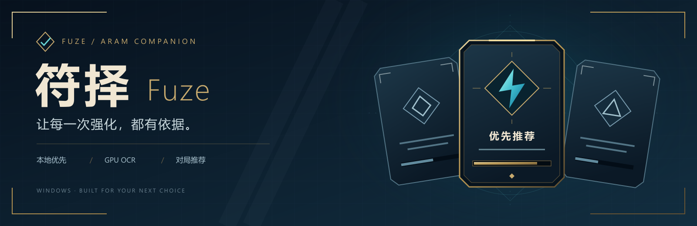
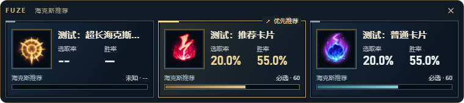

<h1 align="center">Fuze</h1>

<strong>See your three Augments. Make your own choice.</strong>

Windows · Local recognition · Chinese League client workflows

<a href="https://github.com/ye602a/fuze-assistant/releases/latest"><strong>Download</strong></a> · <a href="https://github.com/ye602a/fuze-assistant/releases">Release notes</a> · <a href="README.md">简体中文</a>

## Stay focused on the match

Fuze connects to your League client and recognizes the three Augment choices in ARAM Mayhem. Recommendations keep the game's left-to-right order. Every selection and reroll remains yours.

| During | What you can see |
| --- | --- |
| Champion select | Your champion, bench candidates, builds and skill references |
| Augment selection | Recommendations beside the corresponding three choices |
| After a match | Locally saved offer observations and available personal match history |
| Between games | Connection status, overlay preferences and local storage controls |

The image uses test names and statistics. Aggregate rates are references, not predictions for a single match.

## Get started

1. Download `Fuze-Setup-<version>.exe` from [Releases](https://github.com/ye602a/fuze-assistant/releases/latest).
2. Open Fuze, start League and sign in. Check the actual connection status on the home screen.
3. Play ARAM Mayhem normally and view the recommendations when choices appear.

This is a private testing repository; downloads require repository access. Borderless or windowed mode is recommended. Remote desktop and different GPU setups require their own validation.

## Local and under your control

Recognition runs locally without uploading screenshots. GPU recognition can fall back to CPU. Existing recommendation data uses local caches. Software updates require your download and installation confirmation; installation is blocked during champion select and games.

Three-card recommendations currently use overall statistics. Levels are not treated as proof of a claim stage. Online match history depends on available client services; local records cannot recreate data that was never received.

The default branch may contain unreleased work. Read the [release notes](https://github.com/ye602a/fuze-assistant/releases) for the exact features in your installer.

[Player guide (Chinese)](docs/PLAYER_GUIDE.md) · [Development](docs/development/README.md) · [Acknowledgements and third-party notices](THANKS.md)
