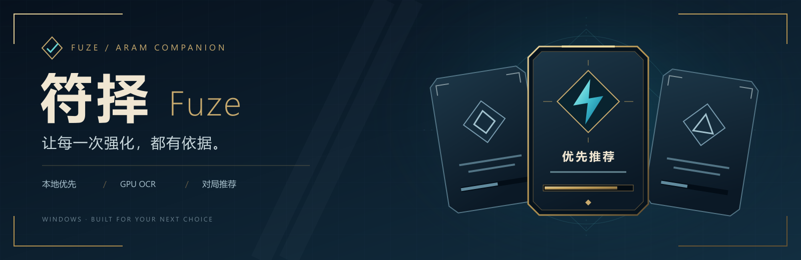
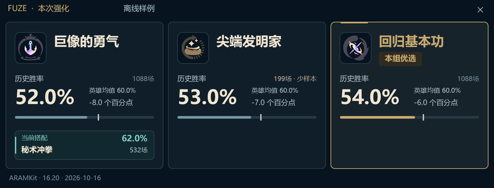
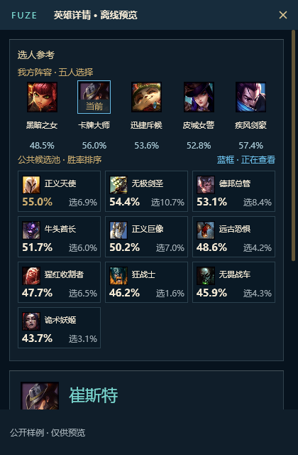
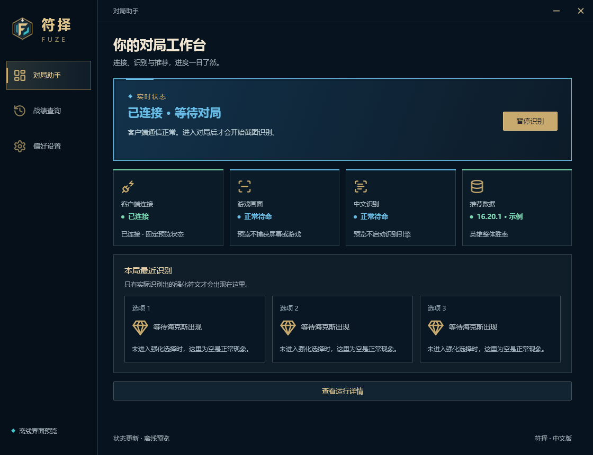

<a href="README.md">简体中文</a> · <strong>English</strong>

<h1 align="center">FUZE</h1>

<strong>Compare your augment choices. See where your build can go next.</strong>

League of Legends: ARAM Mayhem companion · Windows x64 · Simplified Chinese app UI

<a href="https://github.com/ye602a/fuze-assistant/releases/latest"><strong>Download latest</strong></a>　·　<a href="docs/PLAYER_GUIDE.md">Player guide (中文)</a>　·　<a href="https://github.com/ye602a/fuze-assistant/releases">Release notes</a>　·　<a href="https://github.com/ye602a/fuze-assistant/issues">Report an issue</a>

FUZE displays augment statistics and choice guidance in the same left-to-right order as the three cards in your game. Once an augment pick is confirmed, it becomes context for later combination references. Champion selection and item-set import are available in the same companion.

Offline preview of the current native UI. Fixed example values do not represent current statistics.

## Understand the stats and the current choice

| Card information | What it helps you assess |
| --- | --- |
| **Historical performance** | An augment's win rate and sample size for your champion, including its difference from the champion's average. |
| **Current choice guidance** | A preferred-choice badge below the title, with a matching gold title, border and win-rate bar. Falling below the champion's average does not automatically mean an augment is a poor choice. |
| **Stage comparisons** | When evidence supports a difference, see the other card being compared and the direction at each relevant selection stage. |
| **Combination routes** | Current combinations show available historical evidence. Follow-up guidance highlights one augment, with icons and names for up to three other targets. |

When no route is available for your champion, a separate **cross-champion reference — unverified for this champion** can suggest another combination to explore. These references supply no win-rate claim for your champion and do not affect the choice ranking.

The overlay can be moved or closed. Key information stays on the cards; keep choosing augments in the game, and FUZE records confirmed picks automatically.

## From champion selection to item builds

Offline application preview with example data.

- **Compare your options.** View the allied lineup and candidate champions by their titles. Two- and three-choice prompts follow the client's order.
- **Wait for a wanted champion.** Click the shared-pool action to start attempting a swap; click again or press **F9** to stop.
- **Bring a build into the shop.** Choose an ARAM Mayhem build and import it into the in-game shop's **Item Sets**.

## Download and start

Open the [latest stable release](https://github.com/ye602a/fuze-assistant/releases/latest):

| Option | How to use it |
| --- | --- |
| **Installer** | When Setup is included, download `FUZE-Setup-…-windows-x64.exe`, install it and launch the shortcut. |
| **Portable ZIP** | Download `FUZE-…-windows-x64.zip`, extract the complete archive and run `FUZE.exe`. |
| **Existing installation** | Check for an application update under Settings → Data and updates. |

Sign in to League of Legends, open FUZE and confirm the client connection before entering ARAM Mayhem.

After installing, check for updates in Settings to get the latest online version.

FUZE currently supports **Windows x64 with Simplified Chinese game text**. The app UI is also Simplified Chinese; this page is an English introduction. Screen recognition uses the **primary display**. Required VC++ DLLs are bundled. The installer is currently unsigned, and GitHub's `Source code` archives are not runnable application packages.

## Reading the references

- **Historical results have limits.** Interpret win rates alongside your champion, team and playstyle. Cards omit reference modules with missing or invalid data; small samples in displayed statistics are labeled.
- **Stage statistics are separate from detecting the current selection.** FUZE does not yet reliably identify the actual formal augment-selection stage. A follow-up route is not a promise that its missing augments will appear.
- **Evidence stays distinct.** Your champion's records take precedence, while cross-champion routes have their own label. [ARAMKit](https://aramkit.cn/) supplies the main champion, augment, combination and item-build data; Tencent 101 provides supplementary recommendations for available versions.

See the [player guide (Chinese)](docs/PLAYER_GUIDE.md) and [data acknowledgements](THANKS.md) for details.

## Built for use alongside a match

FUZE's services and native desktop UI are built with Rust. Reducing memory use and CPU overhead is a development priority: recognition is scheduled around match state, unchanged frames can reuse results, and reference data is read from local caches first. Actual resource use varies with hardware, resolution and recognition backend.

Augment recognition runs locally, and screenshot records stay on your computer. For troubleshooting, export a redacted report from the app. Optional automatic GitHub feedback requires separate authorization and publishes summaries in Issues. See the [feedback guide (Chinese)](docs/PLAYER_GUIDE.md#反馈问题).

View the main window

Offline preview; connection states and data versions are examples.

---

<a href="https://github.com/ye602a/fuze-assistant/releases/latest">Download FUZE</a> · <a href="docs/development/README.md">Developer documentation</a> · <a href="THANKS.md">Acknowledgements</a> · <a href="https://github.com/ye602a/fuze-assistant/issues">Report an issue</a>

