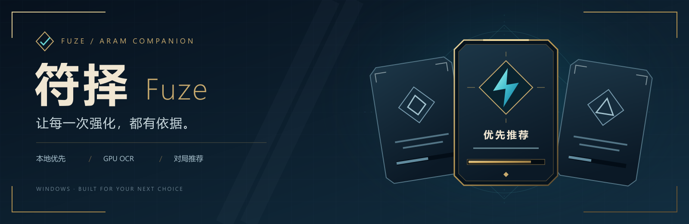
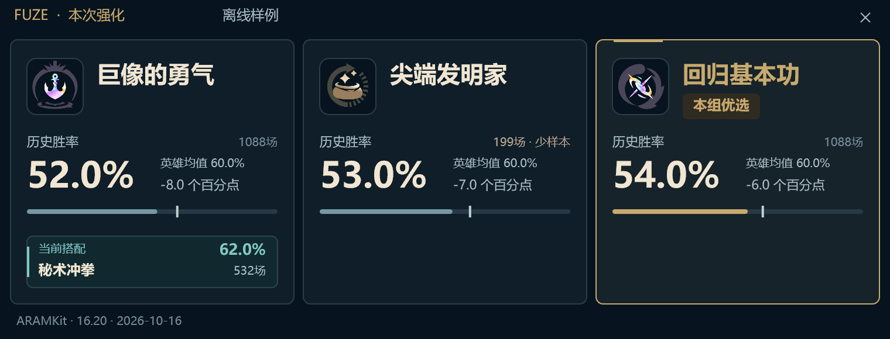
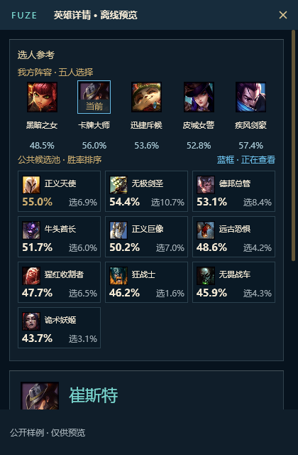
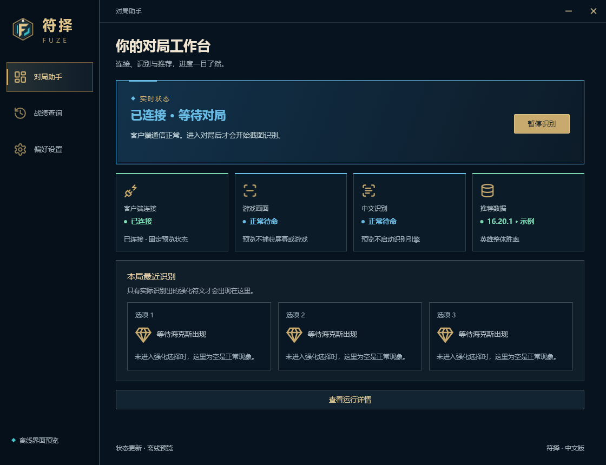

<strong>简体中文</strong> · <a href="README.en.md">English</a>

<h1 align="center">符择 FUZE</h1>

<strong>看清这轮怎么选，也了解后续怎么搭。</strong>

《英雄联盟》海克斯大乱斗助手 · Windows x64 · 简体中文界面

<a href="https://github.com/ye602a/fuze-assistant/releases/latest"><strong>下载最新版</strong></a>　·　<a href="docs/PLAYER_GUIDE.md">使用指南</a>　·　<a href="https://github.com/ye602a/fuze-assistant/releases">更新记录</a>　·　<a href="https://github.com/ye602a/fuze-assistant/issues">反馈问题</a>

强化出现时，FUZE 按游戏中的左、中、右三张卡展示统计与选择参考。确认已选海克斯后，下一次选择还能接着看搭配；选人参考和出装导入也在同一个助手里完成。

三卡浮窗早期布局的离线预览，数值为固定示例。0.7.13 增加的阶段对照与第二条路线见下方说明。

## 看历史表现，也看这组三选一

| 卡片上的信息 | 帮你判断什么 |
| --- | --- |
| **历史表现** | 查看本英雄的强化胜率、样本量，以及相对英雄平均胜率的差异。 |
| **本组建议** | 对照当前三项候选，显示选择状态与理由；低于英雄均值不会直接被判为不推荐。 |
| **阶段对照** | 查看四次强化的统计，以及与另一张候选在哪些阶段有明确差异，例如“对中卡：1/2优 · 3/4弱”。 |
| **搭配路线** | 根据确认持有的海克斯，查看当前搭配、后续路线和第二条具名路线；已有历史记录时提供胜率与样本参考。 |

本英雄没有对应路线时，可以看到单独标注的**跨英雄参考 · 待本英雄验证**，帮助发现其他搭配思路。这类线索不提供本英雄的组合胜率，也不改变本组推荐排序。

浮窗支持拖动和关闭，关键信息直接展示在卡片上；照常在游戏里选择即可，FUZE 自动记录确认选中的海克斯。

## 从选人到出装，少切几个页面

程序生成的离线界面预览；图中数据仅用于展示布局。

- **选英雄有参考。** 我方阵容与候选英雄一起看；二选一、三选一按客户端顺序显示。
- **等待想要的英雄。** 在公共池点击「抢」开始等待换取，再次点击或按 **F9** 停止。
- **出装直接进商店。** 选择海克斯大乱斗出装路线，导入游戏商店的**装备方案**，对局中随时查看。

## 下载后怎么用

打开[最新正式发布页](https://github.com/ye602a/fuze-assistant/releases/latest)，选择适合自己的方式：

| 使用方式 | 操作 |
| --- | --- |
| **安装包** | 发布页提供 Setup 时，下载 `FUZE-Setup-…-windows-x64.exe`，安装后通过快捷方式启动。 |
| **便携包** | 下载 `FUZE-…-windows-x64.zip`，完整解压后运行 `FUZE.exe`。 |
| **已有 FUZE** | 在“设置 → 数据与更新”检查程序更新。 |

登录英雄联盟，打开 FUZE 并确认客户端连接成功，再进入海克斯大乱斗。选人时看阵容、导入出装，强化出现时看浮窗参考。

当前支持**简体中文 Windows x64**，画面识别以**主显示器**为准。所需 VC++ DLL 已随程序提供；安装包暂未签名。GitHub 的 `Source code` 压缩包是源码，不是可运行的程序。

## 怎样理解这些数据

- **历史统计有适用范围。** 胜率描述已有样本，需结合英雄、阵容和玩法判断。缺少记录、样本不足或版本不符时，会显示相应状态。
- **阶段对照与实际领取轮次分别处理。** 当前尚未可靠识别正式领取轮次；阶段数据用于比较，后续路线也不保证一定出现。
- **来源和参考类型明确区分。** 本英雄统计优先，跨英雄路线单独标注。英雄、强化、组合与海斗出装数据主要来自 [ARAMKit](https://aramkit.cn/)，腾讯 101 提供可用版本的补充推荐。

更多说明见[玩家指南](docs/PLAYER_GUIDE.md)和[数据来源与致谢](THANKS.md)。

## 在后台陪你打完一局

FUZE 使用 Rust 构建核心服务和原生桌面界面，以减少内存与 CPU 开销为开发重点。识别按对局状态调度，复用未变化画面的结果；推荐资料优先读取本地缓存。实际占用随设备、分辨率及识别后端变化。

强化识别在本机完成，截图记录仅保存在本地。需要排障时，可在程序内导出脱敏反馈；可选的 GitHub 自动反馈需单独授权，开启后摘要会公开在 Issues。操作说明见[反馈指南](docs/PLAYER_GUIDE.md#反馈问题)。

查看主界面

离线预览，连接状态和数据版本为示例。

---

<a href="https://github.com/ye602a/fuze-assistant/releases/latest">下载 FUZE</a> · <a href="docs/development/README.md">开发资料</a> · <a href="THANKS.md">致谢与第三方说明</a> · <a href="https://github.com/ye602a/fuze-assistant/issues">反馈问题</a>

