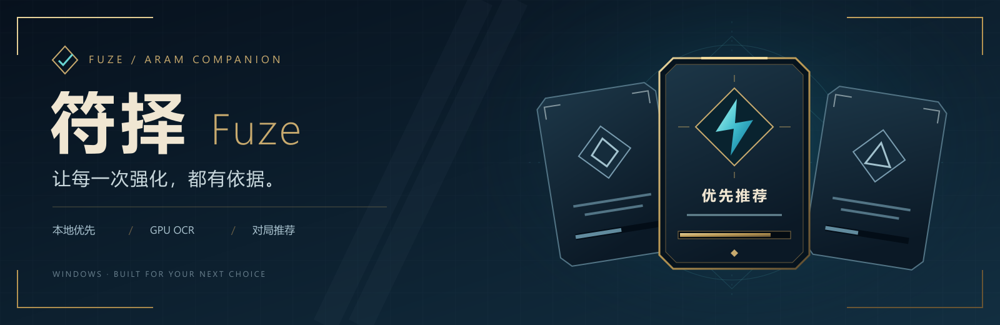
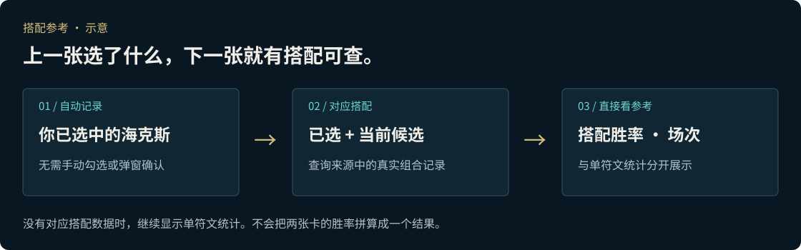
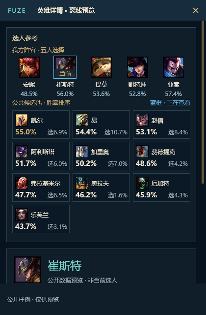
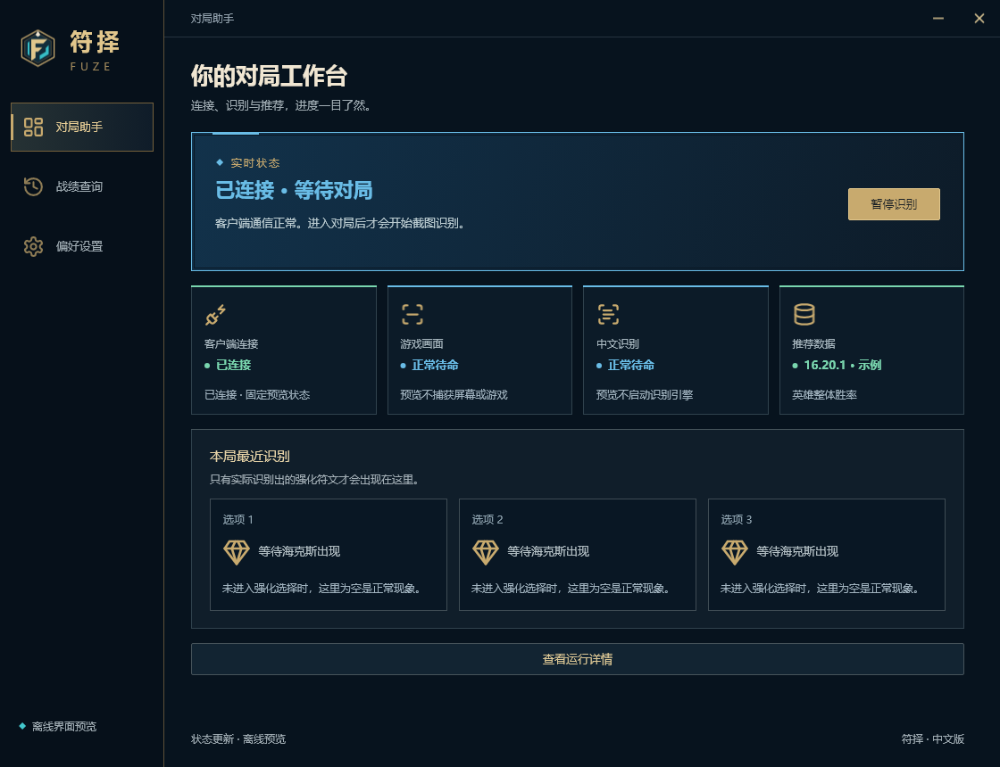

<h1 align="center">符择 FUZE</h1>

<strong>选英雄有参考，选海克斯看搭配，出装直接进商店。</strong>

海克斯大乱斗助手 · Rust 原生开发 · Windows x64 · 简体中文

<a href="https://github.com/ye602a/fuze-assistant/releases/latest"><strong>下载最新版</strong></a>　·　<a href="docs/PLAYER_GUIDE.md">使用指南</a>　·　<a href="https://github.com/ye602a/fuze-assistant/issues">反馈问题</a>

强化出现时，FUZE 在游戏旁显示三张卡片的统计；确认你选中的海克斯后，下一次选择还可以查看对应的搭配胜率。选人、查出装也在同一个助手里完成，少切一次网页，多留一点时间给对局。

| 对局中看强化 | 选人时有参考 | 出装直接用 |
| --- | --- | --- |
| 按游戏卡片顺序显示统计，自动记录已选海克斯 | 我方阵容、候选英雄胜率、公共池抢英雄 | 选择海斗出装路线，导入游戏商店的装备方案 |

## 下一张海克斯，结合已选的来看

强化出现时，三卡浮窗按**左、中、右**展示名称、胜率、选取率和可用的样本数。窗口可以拖动、关闭，不需要点击卡片展开详情。

有对应数据时，额外显示**已选海克斯 + 当前候选**的名称、小图标、两符文搭配胜率和场次。你照常在游戏里选择，FUZE 自动记录确认选中的海克斯，无需手动勾选。

搭配胜率是来源中的历史统计，供你结合阵容和玩法判断；缺少组合数据就保留单符文统计，没有对应版本的统计则显示暂无。不会拿普通大乱斗或旧版本胜率凑数。

## 选英雄时，阵容和候选一眼看全

0.7.11 代码生成的离线界面预览；图中数据仅用于展示布局。

- **看阵容再选。** 五人阵容在上、候选英雄在下；二选一、三选一按客户端顺序显示，完成选择后收起。
- **想要的英雄，点「抢」。** 公共池头像下的按钮跟随客户端窗口移动。点下后显示「停」和目标箭头，锁定倒计时期间也能等待换取；再点一次或按 **F9** 停止，点击另一个目标即可切换。
- **选好路线，导入出装。** 在英雄的「出装」页选择海克斯大乱斗方案，导入后到游戏商店的**装备方案**中查看。不自动购买装备，也不会改写商店内置的「推荐」页；没有该模式的数据时明确显示暂无。

## Rust 原生，把资源留给游戏

FUZE 用 Rust 构建核心服务和原生桌面界面，**以减少内存与 CPU 开销为开发重点**。识别按对局状态调度，复用未变化画面的结果；推荐数据优先读取本地缓存，减少重复下载和计算。

离线界面预览，连接状态和数据版本为示例。实际占用随设备、分辨率及识别后端变化。

平时在后台使用，需要查看连接、识别或数据更新情况时，再打开主界面。强化识别在本机完成，截图日志只保存在本地，不自动上传。

## 下载后怎么用

1. 打开[最新发布页](https://github.com/ye602a/fuze-assistant/releases/latest)，下载 **FUZE 的 Windows ZIP 便携包**，完整解压后运行 `FUZE.exe`。发布页提供 Setup 时，也可以选择安装包；所需 VC++ DLL 已随程序提供。
2. 登录英雄联盟，打开 FUZE，等待客户端连接成功。
3. 进入海克斯大乱斗：选人时看阵容、导入出装，强化出现时看浮窗参考。

**已经装了 FUZE？** 在设置中检查软件更新即可。部分小版本仅更新在线包和便携包，不另外制作 Setup。

GitHub 的 `Source code` 压缩包不是可运行的程序。安装包暂未签名；当前支持简体中文 Windows x64，游戏画面识别以**主显示器**为准。

数据来源、战绩与反馈

- 英雄、强化、组合和海斗出装数据主要来自 [ARAMKit](https://aramkit.cn/)，腾讯 101 提供可用版本的补充推荐。数据更新可能晚于游戏补丁，程序会显示版本情况。
- 支持查看个人战绩和已保存的识别记录。遇到问题可在程序内导出脱敏反馈，在 [Issues](https://github.com/ye602a/fuze-assistant/issues) 附上现象说明。
- 自动 GitHub 反馈需要你单独授权，开启后报告会公开在 Issues；截图仍只在本地保存。
- 抢英雄由你点击启动，仅在选人大厅生效。FUZE 不替你选择局内海克斯，也不自动购买装备。

更多说明见[玩家指南](docs/PLAYER_GUIDE.md)和[数据来源与致谢](THANKS.md)。

---

<a href="https://github.com/ye602a/fuze-assistant/releases/latest">下载 FUZE</a> · <a href="docs/development/README.md">开发资料</a> · <a href="THANKS.md">致谢与第三方说明</a> · <a href="https://github.com/ye602a/fuze-assistant/releases">版本记录</a>

