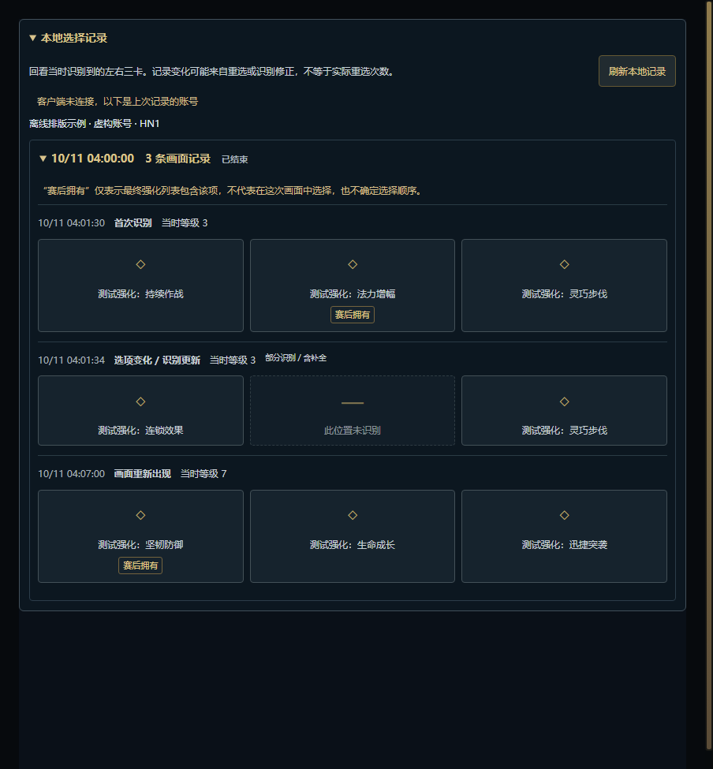

# 本地选择记录

此功能从 v0.5.0 起包含在正式安装包中，复用个人战绩缓存与既有识别链路。

## 如何查看

打开战绩页中的“本地选择记录”，再展开一局即可查看。读取与在线战绩查询分开，SGP/客户端战绩服务失败时仍可读本地选择记录。没有连接客户端时明确展示上次记录的账号；客户端存在但登录身份无法确认时，不显示别人的缓存。

每条记录保留当时接受的左、中、右三个卡位、观察时间、能读取到的等级及部分识别标记。首次识别、选项变化和画面重新出现分别标记。缺失位置保留空格，不把两张卡重新排列为左、中。

截图使用虚构账号、测试强化与占位图标。宽窄窗口均通过排版检查，并非国服真实对局或真实强化选择证明。

## 证据边界

- 复用自动识别链路已经接受的完整或部分结果，包括该链路保留的稳定卡位。OCR 仍可能识别错误；后来的识别修正会成为新的记录，不修改过去的观察。
- 画面消失不代表已经选择。重新出现不一定是新的正式强化轮次，变化次数也不等于真实重选次数；不会用 3/7/11/15 级反推四次选择顺序。
- 已被现有识别器确认的属性碎片走原来的忽略路径，不写入正式三卡记录。不熟悉的碎片仍受识别器现有准确率限制；本次没有新增碎片 OCR。
- 赛后缓存存在同一账号、区服、对局 ID 时，才把最终强化 ID 与观察记录比对。“赛后拥有”仅说明最终列表含该项，不确定它在哪次画面、哪个位置被点击。赛后列表没有的项目也不据此判为“未选择”。
- 只记录本版本运行期间、游戏会话能确认的海克斯大乱斗（队列 2400）。开始记录时需要 LCU 返回当前账号、区服、对局 ID 和 InProgress 阶段；身份或会话读取失败时，本次阶段不猜测归属、不反复轮询。重连进入 InProgress 时可重新建立归属。
- 时间是本机观察时间，不是服务器游戏时间。等级读取失效时显示未知。中途启动、识别未捕获、异常退出及重连都可能留下缺口；旧版本和以前的对局无法补录三卡。

## 开销与存储

- 不增加截图、OCR、游戏内存读取、玩家输入或图像哈希。开始一个 InProgress 阶段时读取一次本地会话与本人资料，必要时沿用现有区服解析；识别循环内没有新增网络请求。
- 同一连续显示期间重复的三卡 ID 不新增记录、不重新安排写盘。缺失/恢复卡位和重现会保留独立观察，避免把识别状态变化隐藏掉。
- 首次变化后 2 秒合并异步写入；结束阶段和正常退出时保存。没有常驻保存轮询或写入失败后的定时重试；异常断电可能丢失尚未落盘的短暂变化。
- 所有账号合计最多保存 100 局，每局 80 条；达到上限会标记截断。界面显示当前账号最近 20 局，展开一局才渲染三卡明细，保持左右位置。
- 缓存位于统一应用数据目录的 `match-history/augment-journal-v1.json`。与个人战绩缓存分别保存，按账号、区服和对局 ID 隔离。
- 仅保存账号标识/显示名、区服、对局 ID、观察时间、等级、状态、强化 ID，以及v0.5.0 的固定计数和白名单异常类别。这些属于本机个人数据；不保存图像、原始 OCR 文本、令牌、其他玩家信息、资源 URL，不上传。
- 原文件通过临时文件成功写入后原子替换。损坏文件保留并提示失败；重启时未正常闭合的记录标记为可能不完整。当前界面为只读，不提供更改或伪造选择的入口。

## 验证

新增测试覆盖卡位与缺失位置、重复帧去重、上下限、只保存允许字段、文件重载、账号/区服隔离、迟到的会话响应、重连与退出、损坏及写盘失败恢复、会话 HTTP 状态、队列校验、无在线战绩的离线查询和赛后 ID 关联。界面测试覆盖按需读取/渲染、展开收起、延迟响应、账号失效和错误提示。

本地测试及隐藏 Electron 排版检查不能代替国服实战验收。发布前仍需在真实对局验证：开始记录、正常三卡、部分识别、重选、碎片链、重新打开选项、比赛结束、重连和赛后关联。

## 识别摘要与筛选

v0.5.0 已扩展每局摘要：即使没有三卡事件，已确认的对局在结束时也保存简短计数；旧文件仍可读，但无法补算过去的摘要。展开一局才渲染摘要，英雄/结果筛选来自同账号同区服同局的赛后资料。详见 [摘要与复盘筛选](RECOGNITION_RECAP.md)。
