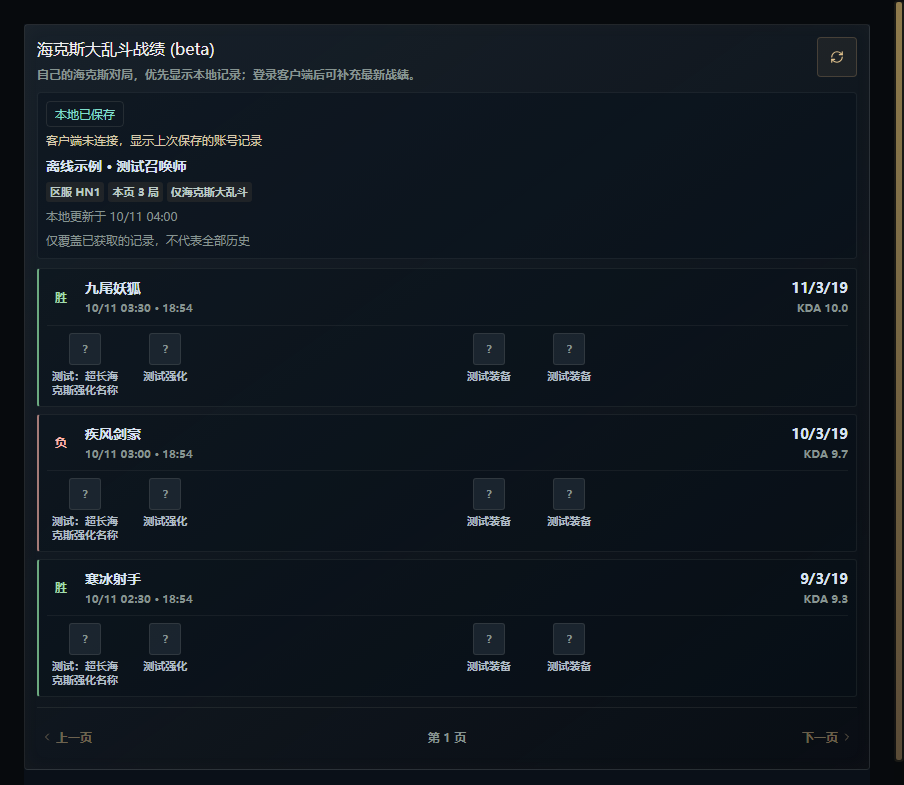

# 个人战绩：本地保存与接口回退

此功能位于开发分支，尚未发布安装包。它解决区服来源单一、接口失败导致页面空白、已有战绩无法离线查看的问题；不保证所有腾讯区服的上游战绩接口可用。

## 玩家可见行为

- 打开战绩页先读取当前账号已保存的记录，再尝试补充在线战绩。客户端未连接时明确显示“上次保存的账号记录”；发现客户端但无法确认登录账号时，不借用其他账号的缓存。
- 自动依次读取当前账号/授权信息、聊天资料和腾讯登录 issuer 的区服提示。最后可从已验证属于当前账号的客户端战绩响应补充区服，不要求手填游戏目录，不沿用上次登录的大区。
- 优先请求 SGP 海克斯摘要；失败后读取客户端最近最多 50 场，再筛选海克斯对局、与本地记录合并并分页。这两个接口可能共享上游，因此回退不是独立数据供应商，也不能保证成功。
- 页面标记“在线战绩”“客户端与本地记录”“本地已保存”，并区分未登录、无法确定区服、授权失败、拒绝访问、限流、服务异常、响应格式异常、账号变化及缓存读写失败。错误响应不伪装成没有战绩。
- 本地和客户端回退页面明确提示覆盖范围有限。在线分页不删除已经保存的旧场次；客户端近期窗口没有海克斯对局时仍保留本地旧记录。
- 软件观察到游戏运行后，在结算或返回大厅稳定 10 秒后尝试更新一次。再次进入选人、载入或断开时取消尚未开始的更新。失败后由玩家手动刷新，不周期重试。

## 性能与隐私

没有增加截图、OCR、轮询定时器、逐场详情下载或重复哈希计算。相同分页并发请求合并；客户端近期列表复用 30 秒；前台 SGP 请求超时为 5 秒，401 重新获取授权后只重试一次，429 至少冷却 60 秒且尊重更长的 Retry-After。选人/载入/对局中只显示缓存；已经发出的请求不强制中止，但阶段变化会阻止后续回退请求。

新缓存位于应用数据目录的 `match-history/personal-history-v1.json`，通过统一的 `getMatchHistoryDataDir()` 获取实际位置。每个账号与区服组合保留最多 500 场，最多 5 个组合。首次读取后复用内存；写入按对局 ID 合并并原子替换，损坏的原文件保留不覆盖。

只保存本人账号标识、显示名、区服及本人的对局结果、英雄/强化/装备 ID、KDA 等字段；这些仍属于本机个人数据。不会保存 LCU/SGP 令牌、完整认证响应、其他玩家列表、外部资源 URL 或上传队列。标签和图片从当前语言的数据缓存重新补齐。新 IPC 经过现有可信窗口检查，渲染层没有新增 Node 或认证信息访问权限。

## 验证范围

单元测试覆盖多来源区服识别、503 回退、混合模式分页、请求合并、限流冷却、401/403 区别、格式错误、缓存损坏、换号/换区、对局中暂停、比赛结束的一次性更新和页面缓存优先显示。宽窄窗口使用真实 Vue 组件与隐藏 Electron 窗口渲染，关闭外部网络，以虚构账号和对局检查来源提示及排版。

上图为离线测试数据，图标为占位，不代表真实账号或腾讯接口成功。当前开发验证时 League 客户端没有启动，因此仍需登录国服确认区服识别、真实 SGP/LCU 响应和一局结束后的保存。线上 503、403 或字段缺失可能同时影响两条读取路径；本地只能保留已经成功取得的记录，不能补回从未取得的历史。

后续的个人强化选择时间线、备选三卡和重选记录仍是独立功能，本次没有把赛后四个强化 ID 伪装成完整选择过程。
