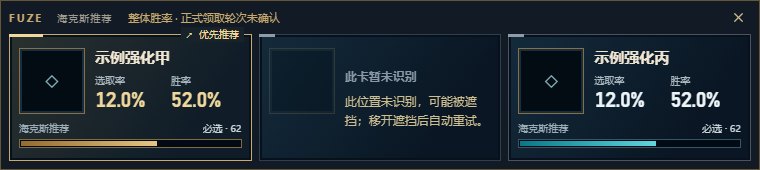

# Recognition latency and discovery review

## Packaged baseline

The local 0.6.2 match on 2026-10-14 ended at 22:27:58 (UTC+08). Its automatic recognition service ran for 529,026 ms: 286 captures, 73 analyses, six detection updates and 17 backpressure skips. Detection updates are not confirmed claims or reward rounds.

- At 22:22:45, a slow title-stack analysis took 13,252 ms: preparation 25 ms, OCR worker path 8,742 ms, name matching 4,485 ms. This is not a measurement of pure GPU inference or complete on-screen latency.
- The OCR worker had been released at 22:22:02 by its two-minute idle timer. Reloading is a plausible contributor to the next OCR stall, not a fully isolated performance measurement.
- At 22:19:17 and 22:25:31, matching alone took 4,207 and 5,026 ms. The old foreground locale lookup could repeat process discovery when process metadata was unreadable, despite an otherwise usable LCU connection.
- Successful three-card updates took 170–364 ms. Capture averages in two later windows were 29 and 68 ms. The startup capture took 2,470 ms.
- No accepted partial-card event was found in this match. The missing-slot change is regression-tested behavior, not proof of a recorded obstruction event.

Only aggregate timings and counters are recorded here. Raw logs, account identifiers, credentials, screenshots of actual games and installation paths are excluded.

## Changes

1. OCR uses a cached locale hint immediately; optional refresh runs in the background through an already verified LCU connection. It never starts process discovery from matching.
2. One initialized worker stays available during gameflow-owned recognition. No extra inference or heartbeat is added. The existing two-minute idle release resumes after recognition stops.
3. Level telemetry refresh no longer blocks capture. One positive cheap selection gate schedules its confirming frame after at most 500 ms instead of the ordinary 1,500 ms interval; two-frame confirmation and OCR backoff remain.
4. With independently confirmed selection UI and two known titles, an unread position gets a fixed left/center/right placeholder. Brief losses retain existing cards for the existing 2.5-second grace; persistent losses become placeholders. One known card alone is insufficient. The hint says “possibly covered,” because failed OCR does not prove obstruction.
5. When client processes exist but metadata yields no credentials, bounded registry/shortcut discovery finds install candidates. Candidates must pass the local read-only gameflow probe before use. Discovery stays process-first; manual directory remains the final fallback. Metadata rescans are limited to five minutes and attempts to 30 seconds, with one in-flight operation. No full-drive scan is added.
6. The main page and three-card window explicitly label the current basis as overall win rate with an unconfirmed claim round. Automatic stage statistics remain disabled.

## Verification boundary

The new installation discovery resolved a valid local candidate and passed a read-only gameflow request without printing credentials. Unit tests cover nonblocking optional inputs, model lifecycle, partial positions and grace, coalesced discovery, and HTTP failure/timeout handling. Isolated renderer checks use fictional recommendations across all three locales; OCR fixtures use isolated data.

Source tests and fixture timings do not establish patched packaged performance during a live match. The installed application was not replaced or restarted. A future packaged match should check that no worker idle release occurs between offers, matching no longer includes process-discovery stalls, and persistent missing slots appear without exposing shard selections as normal augments. Actual claim validation remains a separate prerequisite for automatic stage-based recommendations.
