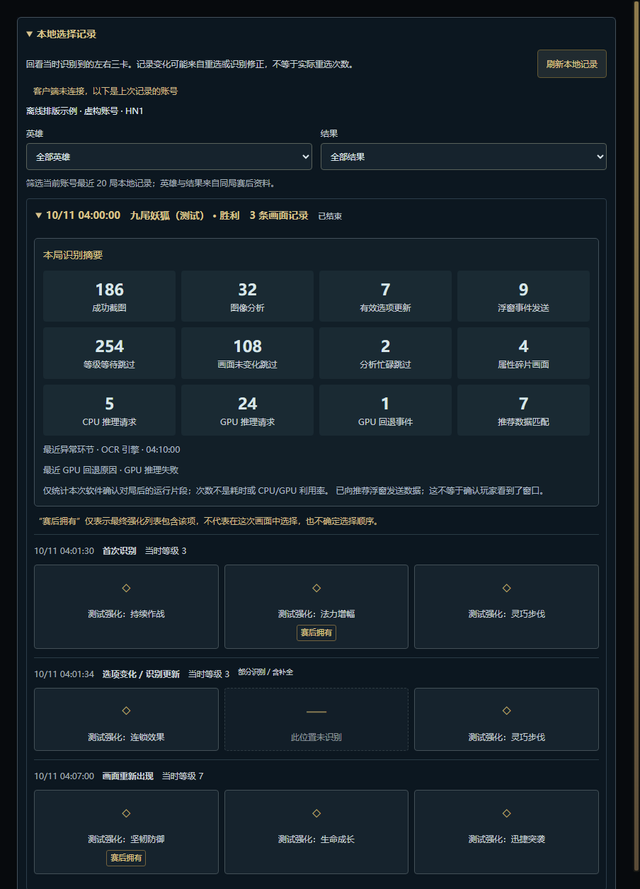
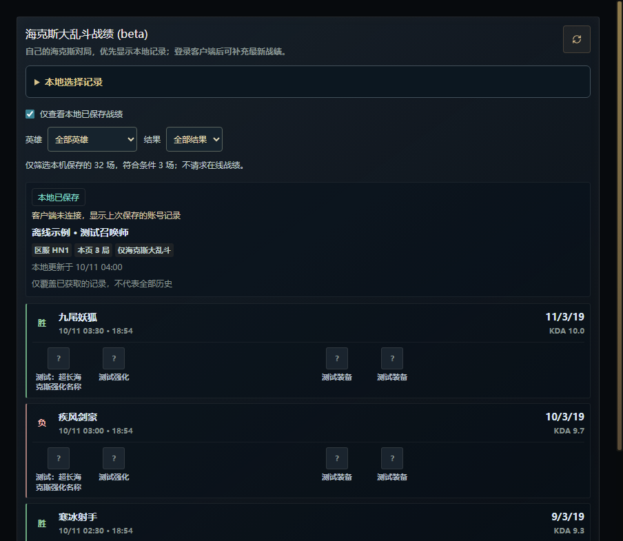

# 每局识别摘要与个人复盘筛选

开发分支功能，尚未包含在正式 v0.4.2 安装包中。

## 玩家入口

战绩页展开「本地选择记录」，展开一局后查看「本局识别摘要」。即使本局没有接受任何三卡结果，已经验证归属的海克斯对局结束后也会留下摘要。旧版本记录继续可读，缺失摘要明确提示，不能补算。

本地选择记录按英雄、胜负、重开或「赛后资料未取得」筛选当前账号最近 20 局。英雄与结果只关联同账号、区服、对局 ID 的本地赛后记录；没有赛后数据时不猜测。

战绩页勾选「仅查看本地已保存战绩」，按英雄与结果筛选当前账号全部已保存记录（最多 500 场），再以每页十场呈现。显示保存数量、筛选命中数量；没有结果时明确提示。不会为了筛选请求 SGP 或客户端战绩接口；仍按既有逻辑确认当前账号，并在读取后再次验证身份。筛选期间的旧在线响应不能覆盖新结果。

图片全部使用虚构数据与占位图标，不包含真实玩家记录。920/560 像素隐藏窗口均检查无横向溢出。

## 计数语义

| 指标 | 含义 |
| --- | --- |
| 成功截图 | 现有截图服务返回成功的次数；包含现有策略复用的候选帧，不保证每次是新的桌面采样。 |
| 图像分析 | 完整图像分析入口次数，不含轻量选择界面门控；可能复用已有 OCR 缓存。 |
| 有效选项更新 | 自动链路接受并准备通知的完整或部分选项更新；不是选择次数或重选次数。 |
| 等级等待、画面未变化、分析忙碌跳过 | 对应既有调度判断次数，不是秒数，不推算省下的 CPU 时间。 |
| 属性碎片画面 | 现有分类器判断为碎片的分析结果次数，不是购买或领取数量。 |
| CPU/GPU 推理请求 | 实际发送到 OCR 工作进程的识别请求，包含失败尝试和 CPU 重试；预热不计入。一次图像分析可能产生多个请求，也可能使用缓存而没有请求。 |
| GPU 回退事件 | 确认归属后的 GPU 初始化失败、推理失败或工作进程退出事件；选人时已经发生的回退不追溯到对局。 |
| 推荐数据匹配 | 推荐补充请求至少匹配一个强化的次数；不表示所有三卡均有数据。 |
| 浮窗事件发送 | 至少向一个启用的推荐浮窗发送了数据；不证明画面实际可见或玩家看到了。 |
| 最近异常环节 | 白名单类别和本机时间，可能已恢复，不等于当前仍故障；不保存原始错误信息。 |

摘要只覆盖软件确认当前账号、区服、对局 ID 和 InProgress 之后的运行片段。中途启动、失联、重连、异常退出会有缺口。零次有效结果可能是没有出现选择画面、功能关闭或识别异常，不能仅凭零次作故障诊断。正常退出尽力保存；无三卡事件且进程被强制结束时，未落盘摘要可能丢失。

这不是 CPU/GPU 利用率或内存采样工具。尚无本轮国服真实整局性能对照，不能宣称实机占用降低。

## 生命周期、性能与隐私

- 仅在已确认的当前对局启用一个固定大小计数器；同一局重连沿用计数，另一局清零。所有异步结果带计数会话编号，旧会话结果不能写入新摘要。
- 同步事件只增加整数与时间。没有新增截图、OCR、图像/文件哈希、网络轮询或写盘定时器。
- 复用本地选择记录的两秒合并写入及阶段结束/退出保存。纯计数变化不会启动写入。摘要和三卡共同受 100 局保留上限保护，每局三卡仍最多 80 条。
- 存储沿用应用数据目录内个人记录文件，不上传。摘要只序列化计数、固定后端/回退/失败类别与时间；不保存 token、URL、原始错误或 OCR 文字。
- 新增可选字段兼容旧记录；损坏的可选摘要会被忽略，不丢弃其三卡记录。用户原文件不会因为读取旧格式被删除。
- 新 IPC 方法未增加；查询字段在主进程限定英雄 ID、结果枚举和已有分页边界。在线查询入口收到本地复盘请求时也只读取本地记录。

## 验证边界

单元测试覆盖计数与推理请求区别、真实工作进程接口的模拟 GPU 回退、零三卡保存、重连累加、新对局与迟到响应隔离、旧格式、保存字段白名单、按全缓存筛选后分页、账号切换与界面旧响应防护。另运行类型/代码检查、生产构建、真实 OCR 图片回归及宽窄窗口排版验证。Windows 发布流程还需实际打包、凭据扫描与真实打包窗口启动检查。

实战验收仍需玩家进入国服对局，确认等级等待、普通强化、碎片连续画面、CPU/GPU 回退和结束保存的实际记录；自动化检查不代替该验收。
