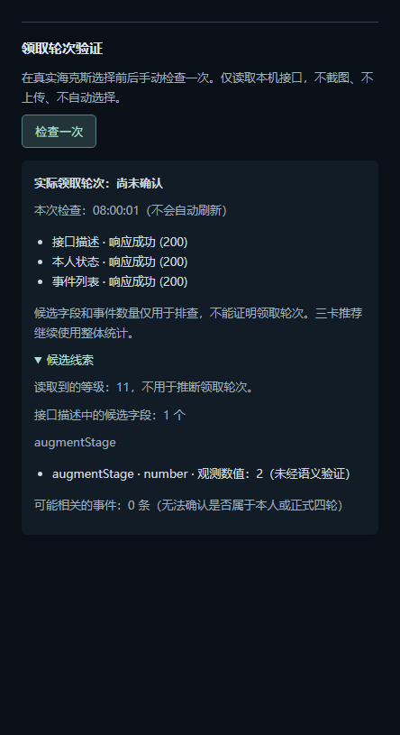

# 实际领取轮次：手动信号检查

状态：开发功能，尚未确认国服存在可靠的实际领取轮次字段。没有接入自动阶段排序。

## 为什么先做检查入口

现有等级门控仅调度截图，候选卡历史仅记录观察，二者都不能证明实际领取。根据 [Riot 官方文档](https://developer.riotgames.com/docs/lol#game-client-api)，游戏运行期间提供本机 Live Client Data 接口和 OpenAPI 描述。公开示例没有可直接依赖的海克斯领取轮次字段，需要真实国服验证，不能猜测字段语义。

偏好设置 → 连接与诊断 →「领取轮次验证」新增「检查一次」。进入该页面不发请求；点击后最多顺序读取三次固定 `https://127.0.0.1:2999` GET：

- `/swagger/v3/openapi.json`：检查属性声明中是否出现少量已知候选字段名。
- `/liveclientdata/activeplayer`：只提取等级，以及顶层候选字段的类型、有限数组长度和 0–4 整数。
- `/liveclientdata/eventdata`：只统计三个候选事件名出现次数，不输出事件内容或参与者。

接口不需要 LCU 凭据。不会读取 lockfile、进程参数或游戏内存，也不会连接远程站点、截图、操控游戏或启用回放 API。

## 如何解释结果

「响应成功」仅表示 HTTP 200 且 JSON 可解析，**不表示字段语义正确或轮次确认**。`actualStage` 始终为 null，界面始终显示尚未确认。即使出现 `augmentStage: 2`，也仅是未经验证的候选线索。

- 描述文件里的候选字段可能属于其他模式或无关对象；存在不等于 activeplayer 实际提供。
- 当前检查只认识 `augments`、`selectedAugments`、`augmentSlots`、`augmentIds`、`augmentStage`、`currentAugmentStage`、`augmentChoiceIndex`、`augmentCount`。不支持任意深度玩家对象解析；未知或嵌套字段不会出现在结果中。
- 候选事件名仅为 `AugmentSelected`、`AugmentChosen`、`AugmentGranted`，尚未经国服验证。事件数量不确认本人归属、事件唯一性、正常轮次、重选或额外选择。
- 没找到已知字段不证明能力不存在。HTTP 错误、超时和异常格式分别显示，不等同于成功。
- 等级、候选数量和事件次数不会推进阶段。三卡保持现有整体推荐，分阶段面板仍为手动参考。
- 页面结果带检查时间，不自动刷新。关闭设置页会丢弃界面结果；下一次检查不继承上次数据。冷却期间只显示上一次带时间的结果及剩余等待提示。

## 国服后续验证

由玩家正常进行游戏，在正式选择前后手动检查，对照本人可见状态。覆盖正常四次、同轮重选、连续碎片、积攒领取、特殊强化额外选择、中途启动与重连。记录只能使用这个白名单摘要，不能上传原始响应或含身份截图。

只有明确验证「本次候选属于正式第几轮」，并证明重连可恢复、额外强化不混入、陈旧响应可失效后，才另做实际阶段适配器。不同接口的三次读取不是原子快照，不能直接组合成已确认状态。未来适配器还需确认会话与本人归属；本检查不建立这些保证。

## 开销与隐私

- 无启动请求、无预热、无后台轮询、无磁盘写入、无上传、无新增依赖。
- 全局共享一个请求任务；连续点击合并，尝试开始后 30 秒冷却，失败也不自动重试。
- 每个请求 1.5 秒总期限；三个请求顺序执行，正常网络等待总上限约 4.5 秒，另加有限本地解析时间。
- 描述响应上限 2 MiB，本人状态/事件各 256 KiB；描述遍历最多 12000 节点、深度 24；事件最多 2048 条；候选数组长度最多显示 32，并标注截断。
- 固定 IPv4 回环地址，不接受 renderer 提供的 URL，不跟随重定向，不发送认证头、Cookie，不经环境代理。仅对这一回环请求容忍游戏自签名证书。
- 原始响应仅短暂在内存解析，不记录日志。只允许固定枚举字段进入 IPC；不传出身份、原始字符串、数组内容、强化 ID、原始错误文本、未知字段名或动态路径。

## 验证边界

单元测试验证脱敏、限额、冷却/合并、失败和超时、不推断阶段及手动界面生命周期。`tests/electron/test-stage-signal.js` 使用内存 HTTP 流替身验证真实请求封装，不连接游戏；已接入 Windows CI。隐藏窗口界面示例为虚构数据，不是实战证据。

该示例使用不存在于本次实测的假定字段值，专门验证候选字段出现后界面仍不确认轮次。隐藏窗口 860/460 像素宽度均无横向溢出，未操作鼠标。
