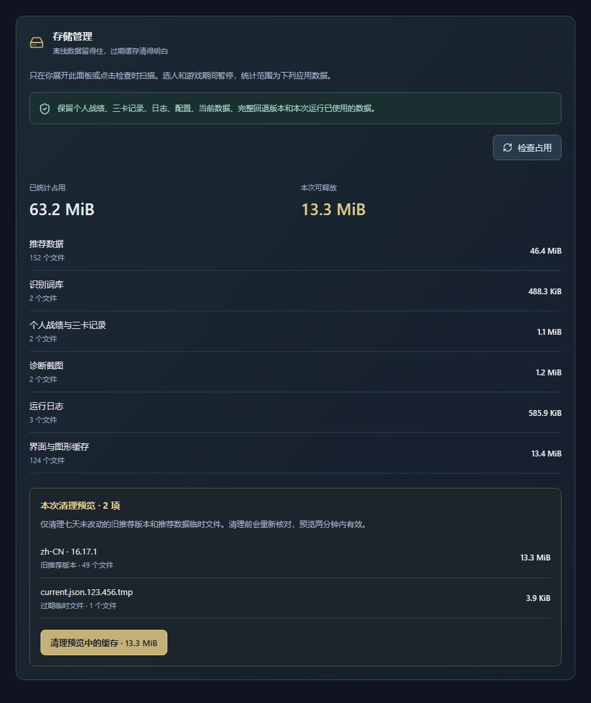

# 存储管理与上传检查

开发分支功能，尚未进入正式 v0.4.2 安装包。

## 使用

在「偏好设置」展开「存储管理」，查看推荐数据、识别词库、个人战绩与三卡记录、诊断截图、日志、界面与图形缓存的占用。这是指定类别的统计，不代表整个应用安装体积或全部 Chromium 用户数据。

先检查清理预览，再点击「清理预览中的缓存」。预览只在本次软件运行内保存一份，有效期两分钟；每次使用后失效。清理成功、部分失败或数据变化后，需要重新检查，不沿用旧清单。

示例使用虚构容量与版本，不是用户目录截图。920/560 像素窗口用真实 Vue 组件和隐藏 Electron 窗口检查，无横向溢出；测试未操控用户鼠标或游戏。

## 清理边界

- 仅允许处理统一应用数据目录内的推荐数据缓存，不接受来自界面的目录或文件路径。
- 按语言分别保护当前指针引用的完整版本、比当前版本更近的新版本，以及一个最近的完整旧版本用于回退。简体中文支持原有平铺目录与语言目录。
- 本次进程已读取或写入的版本全部保留，包括尚未完成的数据下载。清理期间，新版本访问等待清理结束；复用内存数据不触发目录扫描。
- 当前指针损坏、缺失，或无法按清单确认当前版本文件完整时，保留该语言的所有版本目录。完整性在此按文件存在及清单字节数判断，不增加文件哈希或下载。
- 旧版本必须七天未修改，目录中仅包含清单声明的缓存文件或已知临时文件，才进入清理预览。未知文件、目录链接、权限错误均保守跳过。
- 只识别推荐数据写入器生成的两种临时文件名：旧的进程号/时间戳格式，以及新的 UUID 格式；必须超过七天。不会泛删所有 `.tmp` 文件。
- 个人战绩、三卡记录、日志、配置、诊断截图、识别词库和浏览器缓存只统计，不提供删除。
- 清理前重新扫描并核对候选文件元数据；文件发生变化后停止。逐文件删除并逐级移除空目录，不递归删除一个未经核对的目录。只统计已经成功删除的文件，部分失败明确告知。
- 选人、载入、对局或手动识别期间不扫描或清理。开始操作前用只读进程查询确认游戏未运行，过程中检查已有游戏阶段；无法确认时暂不处理。
- 无后台清理定时器、图像识别、网络请求或加密哈希。单次最多遍历 20,000 个节点、12 层目录，清理预览最多 100 项。超出遍历限制会停止，超出候选上限会保留剩余项目供以后检查。

文件系统检查防止普通目录链接跳转和预览后变化；这不是用于对抗具有同等本机权限、精确竞争每次文件操作的恶意进程的隔离边界。

## 上传内容检查

`npm run security:check` 检查 Git 暂存区/已跟踪快照；`--range origin/master..HEAD` 额外检查该开发范围新增的历史对象，避免仅从最新文件删掉密钥却在待上传提交里留下它。应在明确暂存本轮文件之后运行。

规则检查 GitHub 令牌、常见 API 密钥格式、私钥头、JWT、带凭据 URL、明文凭据字段，以及个人历史文件、运行目录和私钥文件。输出仅有文件名、行号、规则名，不含匹配原文。现有 LCU 单元测试的已知虚构凭据有精确例外，范围仅限测试文件和回环地址；测试目录整体仍参与扫描。

Windows CI 在打包前扫描源码，在上传前扫描 `app.asar` 内容（含对应的解包文件）、随包公开数据与更新配置；规则发现问题即失败。忽略规则同时排除本机环境文件、个人历史、运行目录、日志和私钥文件。测试示例图只使用虚构数据。

检查是可维护的泄漏防线，不承诺识别所有密钥格式、经过编码的秘密或图像里的个人信息。GitHub 凭据继续由本机凭据管理器/CI 环境提供，不写入源码、配置示例或安装包。扫描不上传文件到第三方服务。

## 验证

后端测试使用新建的隔离临时目录，覆盖当前与回退版本、语言隔离、过期预览、游戏阶段、修改后的文件和指针、未知文件、损坏/缺失数据、临时文件年龄、目录链接、在用版本及维护期间访问等待。真实用户目录没有执行清理。

界面测试覆盖按需扫描、点击后才执行、迟到响应、预览失效、部分清理失败。上传规则测试验证凭据命中只返回位置，不泄漏匹配内容。另执行全量单元测试、类型与代码检查、生产构建、真实 OCR 图片回归，以及 CI 的真实打包应用窗口检查。
