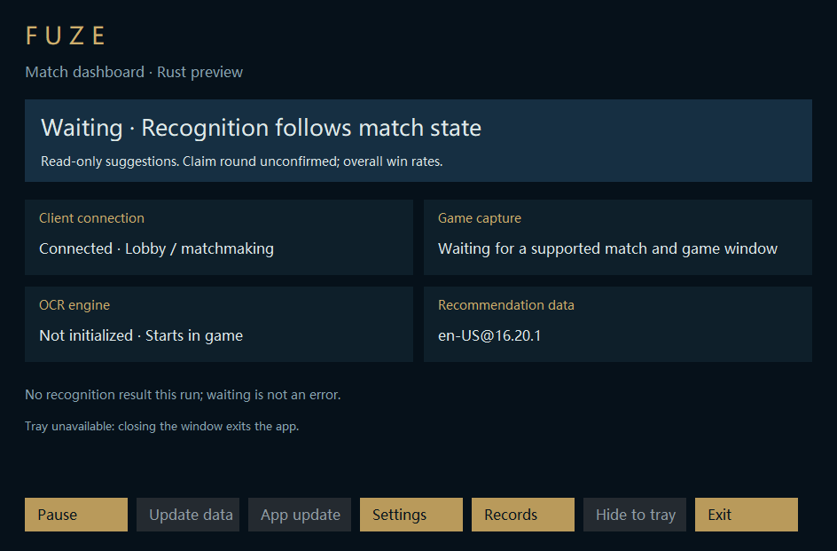

# M10: runtime continuity and release readiness

PR base: `feat/rust-history-detail` (PR #37, Windows checks successful at `a7a493e`). Stable Electron entry and private repository visibility are unchanged.

## Implemented together

- Three-card production windows use the bounded geometry store. Header dragging does not activate the window; showing it preserves position. DPI/display changes clamp to a remaining work area. Fixtures have no persistence hook and cannot read user geometry.
- Updater progress, confirmations, credential prompt and errors support all three UI languages. The desktop passes its resolved locale; standalone commands use saved preferences. Package verification does not read preferences. Fixed error identifiers remain untranslated.
- Managed startup uses READY + HEALTHY after at least three seconds of a running UI message loop, with the engine thread still alive. Pending activation commits only after acknowledgement. Explicit close before health does not reopen a rollback window. Older preview binaries retain legacy readiness compatibility, without claiming sustained health.
- Cleanup runs only after healthy managed launch / completed data activation, never per frame. Keep current/previous binaries, the bundled fallback, and current/previous complete locale data. Bounded metadata traversal rejects links, unknown files and excessive trees; delete known files individually then empty directories. Cleanup failure does not invalidate an update. Interrupted staging folders remain for manual recovery.
- History UI compares shared snapshot identities instead of walking all records every timer tick. V2 history writes a separate file, reading legacy data only if v2 is absent; corrupt v2 is preserved and reported.
- Window-save errors allow retry on the next geometry event; the desktop can display the fixed save-error category.

## Validation

Local Release compilation and hidden managed-desktop smoke passed: READY_2 then HEALTHY_2, pause/resume/exit, native and champion render, game_access=false. The 25-test host library suite passed before the final additional cache-compatibility tests. Final Windows CI runs the existing native pipeline, package, install/rollback and desktop checks, including the new managed health smoke. CI status is reported on the PR. These fixtures do not establish Tencent gameplay compatibility.

## Remaining release gates

| Area | Remaining work / evidence |
| --- | --- |
| Production distribution | Reviewed per-user installer/bootstrap, publisher certificate and Authenticode policy, signed production feed/artifacts, packaged install/uninstall/upgrade acceptance. Native artifacts remain development previews. |
| Long-running operation | Tencent discovery/reconnect, real WGC, GPU/CPU latency, repeated games, foreground/topmost behavior and physical multi-monitor/DPI scenarios. Self-owned windows are insufficient evidence. |
| Startup health | Three-second UI survival is checked. This does not guarantee against later driver faults or an engine thread blocked after initialization. |
| History coverage | External SGP remains absent. Need an unambiguous supported platform route and valid read-only access; never guess a region. Cached history survives query failure. |
| Actual claims / stage rates | No reliable actual-claim signal. Observed choices, shards, forges, levels and rerolls are insufficient. Keep overall win-rate recommendations. |
| Rune pages | Source lacks complete rune-page data; retain unavailable state rather than invent builds or write to the game. |
| Public repository | After full migration only: license/asset redistribution review and all-history, Actions and release privacy audit. No visibility change here. |
| Maintenance edge cases | Interrupted staging trees, unknown or locked files are preserved. Overlay/champion save failures do not yet share a desktop diagnostic. |

Old milestone tables in PROGRESS are historical, not a second backlog. Broad Windows validation is batched for this stage; new failures receive targeted repairs.
