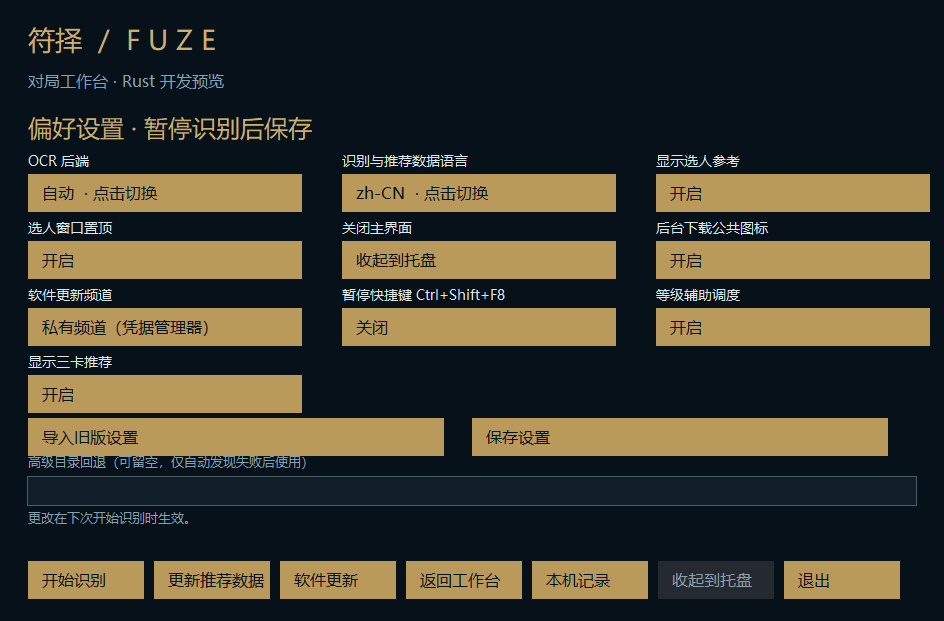
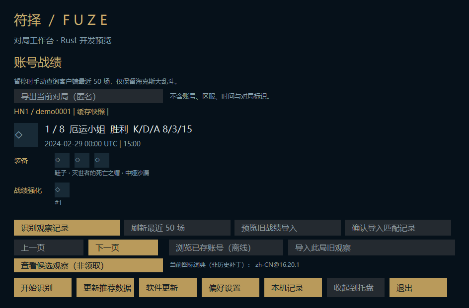

# M11: live level scheduling and explicit local export

Rust preview only. Stable Electron entry and installed user data are unchanged.

## Completed

- Feed the existing level gate from a separate fixed loopback Live Client Data reader. Only a validated integer level survives parsing; the response is bounded and wiped, with no LCU credential forwarding, redirects or proxy.
- One lazy worker polls after each request with a three-second interval. Inactive sessions stop scheduling; generation changes reject in-flight stale results. Samples expire after ten seconds. IO stays off the OCR/UI thread, with per-operation timeouts (not a hard end-to-end cancellation guarantee).
- Missing telemetry clears only the level hint and preserves active-card hints, returning to ordinary fallback recognition. Level, fragments and rerolls never establish actual acquisition order; recommendations remain overall winrate.
- Add level-aware scheduling and three-card visibility preferences, including allowlisted legacy import. New preferences use a separate v2 filename so rollback does not break the older strict reader.
- Add explicit local JSON export of the selected cached match and optional candidate observations. No account, platform, timestamp or match identifier is exported. Candidate observations and result augments remain separate; actual claim round remains unknown. Existing files are never overwritten.
- Three-column native settings layout, translated labels/status and export control. No changes to stable Electron or its security boundary.

## Validation

53 targeted local release unit tests passed (LCU 14, runtime 10, host 29), including generation reset, stale sample expiry, malformed level input, fallback scheduling, partial observations, reduced export and existing-file protection. Final release host build passed. Hidden owned-window desktop renders passed in zh-CN and en-US; game access was disabled. Windows CI is the final integration gate.

The screenshots contain synthetic fixture records only. No live game endpoint, real account history, desktop/game capture or user input was used during development. Real Tencent level telemetry, timing around actual augment appearance and multi-monitor interaction still require opt-in gameplay validation.

## Remaining before a full Rust replacement

Production installer and signing/channel trust, real-game and multi-monitor acceptance, final feature parity review (including rune-page/item-set writes and secondary panels), and public-history/privacy/license audit remain open. This PR does not merge the stacked migration PRs, publish a release or make the repository public. Automatic stage-specific ranking still needs a reliable actual-claim signal. Export is JSON only, not an image-sharing feature.
