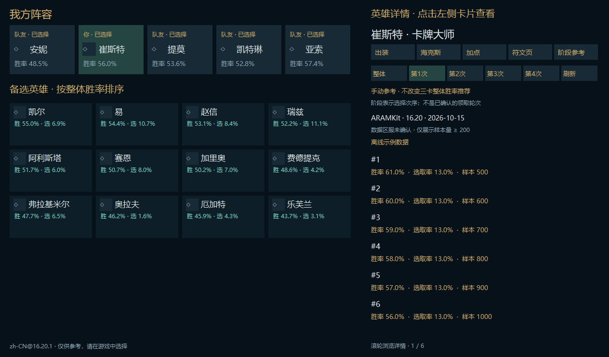
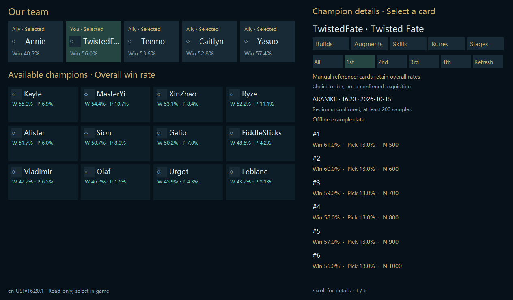

# M13: manual native stage statistics

Stacked on PR #40. Stable Electron and repository visibility remain unchanged.

## Player behavior

The native champion detail window adds a Stages tab. Players select All or choices 1-4 manually, read win/pick rates and sample counts, and explicitly refresh when desired. The panel identifies ARAMKit, patch and data date, cache freshness, unknown source region and patch mismatch. Rows below 200 samples are not shown. Names use the local locale catalog with an explicit numeric ID fallback.

This panel does not write to the game, establish actual acquisition order or change automatic three-card ranking. Levels, shards, forges and rerolls remain insufficient claim evidence; overall recommendations continue.

## Performance and privacy

- One independent latest-request worker; no network, file IO or model work in the paint or OCR thread. The idle worker sleeps.
- Fixed public HTTPS origin `data.aramkit.cn`, using the existing Electron provider contract. No cookies, proxy, redirects or LCU credentials. Only the public champion ID is requested.
- At most eight cached champions, 2 MiB input/cache limits, 512 rows per stage, six-hour freshness and seven-day retention. Reads reuse the cache; stale entries refresh only on explicit request. Success throttles requests for 30 seconds; failure backs off five minutes.
- Existing data remains visible during refresh and survives failed/downgraded responses. Successful writes use the shared atomic JSON helper. Invalid heroes, rates, duplicate rows, paths, versions, dates and oversized responses are rejected.
- Sorting happens when data is loaded. Stage switching only changes the in-memory view. No new frame-level hashes or scans.
- Hero/version changes, hidden views and closure invalidate publication. In-flight WinHTTP requests use the existing bounded timeouts; cancellation is checked between operations, not claimed as hard IO cancellation.

## Validation

Local host tests and targeted stage tests cover disk reload without network, failed/downgraded refresh preserving bytes, cancellation before commit, missing stages, sample threshold, malformed/oversized input and visible snapshot preservation during refresh. Release host build and owned hidden UI smoke passed. Synthetic stage screenshots are generated for zh-CN, zh-TW and en-US; no real desktop/game captures or user data are used. Final Windows evidence is linked in the PR.

A separate credential-free public endpoint probe returned HTTP 200 for patch 16.20, data date 2026-10-14, champion 21: 135 overall rows and 125/133/120/115 rows for choices 1-4, with numeric rate/sample fields. This verifies endpoint availability and basic shape through Node fetch, not the native WinHTTP-to-window or actual-game path. This is a native UI migration, not a claim of Tencent-only statistics or a live latency benchmark.

## Remaining

Signed production installer/uninstall/shortcut integration, secondary augment-panel and image-sharing parity, optional game-write actions, actual claim evidence, physical multi-monitor and long-running real-game acceptance, and final public-history/privacy/license review remain open. The legacy manual-reference migration gap is closed by this PR; automatic stage ranking is still intentionally gated.
