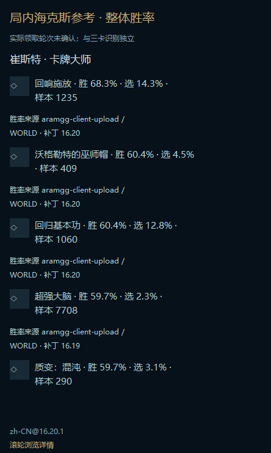
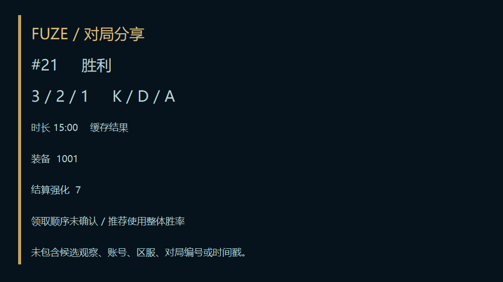

# M14: installation lifecycle, secondary reference and image export

PR #41 was checked at `04b22d3`: Windows `prototypes` succeeded, merge state clean. This milestone is stacked on that branch. It does not replace the installed stable application or make the repository public.

## Player flows

- `Install-local.cmd` adds native Shell Link launch/uninstall entries to the current user's Start menu. No administrator privileges, registry installation or automatic launch. Shortcut targets are the fixed managed launcher and a separate maintenance executable.
- `Uninstall-local.cmd` or the uninstall shortcut starts a temporary native helper outside the installation, then asks for confirmation. The Rust desktop must be closed. It preflights all recognized version trees and owned shortcuts before removal. Changed shortcuts, unknown files, links and oversized trees stop removal. Settings, records, caches and Credential Manager tokens are retained, as are unknown staging files, `update.lock` and the temporary helper. No recursive removal of the user-data root. I/O failures may leave a partial removal and are reported as such.
- The tray menu offers **Show / hide in-game augment reference**, enabled only for fresh, supported in-game context with a known champion. The window is created on demand, uses local champion data and the bounded icon service, stays nonactivating/topmost, remembers geometry and hides on pause, disconnect or phase exit. Closing dismisses it until explicitly reopened. It displays overall statistics, patch/source and an unknown-claim notice. It is independent of OCR and does not make additional game requests.
- Match export retains JSON and adds PNG in the native Save dialog. PNG draws an offscreen memory bitmap from reduced result fields and local public catalogue names; it never captures a window. It omits account, region, match ID, timestamp and candidate observations. Result augments do not imply acquisition order. Missing names fall back to IDs. Save is explicit, local and refuses overwriting existing files; no clipboard or upload.

## Performance and privacy

Shell integration and ownership hashes run only on explicit installation/uninstallation, outside capture/OCR. The secondary view does no file/network work during paint, does not instantiate its workers before explicit opening, and stops its UI timer when dismissed or cleared. Image encoding runs only on explicit export. There is no new image-recognition loop or inferred claim-stage ranking.

## Validation

Targeted host tests cover real Shell Link creation/loading, idempotence, modified-link protection, unknown-file preflight, private sibling retention and reduced PNG output. The native update lifecycle also creates shortcuts in a temporary fixture directory and uninstalls its own copied versions after launch/rollback verification. No real Start menu or installed FUZE directory is touched by development checks.

Own hidden native windows render the secondary panel in all three languages; the share fixture uses synthetic match values. Windows CI remains the final package/lifecycle gate. These checks are not evidence of real Tencent gameplay, physical display/DPI behavior or successful player interaction.

## Remaining boundaries

The package remains unsigned development preview, not a production installer. Windows Apps registration, publisher signing, player-friendly share-card icon layout, external history region acceptance and real-game verification remain open. Actual claim order is still unconfirmed; three-card recommendations continue using overall rates. Repository visibility stays private until the full migration and disclosure audit are complete.
