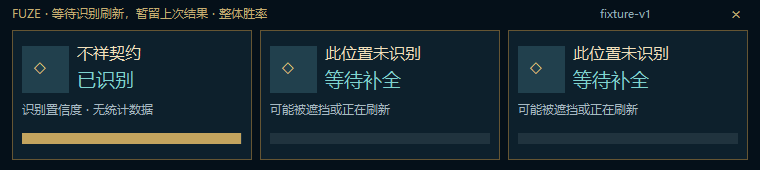

# M17 — title classification, refresh retention and loading prewarm

This milestone is stacked on PR #44 (`0ebf9e6`), whose Windows prototype check passed. It changes only the isolated Rust preview and its validation harness. Stable Electron, game files, user settings and the repository's private visibility remain unchanged.

## Behavior

- The OCR worker now reports one bounded title classification alongside the existing fixed left/center/right slots: `candidate`, `stat_shard`, or `unknown`. It recognizes a deliberately narrow list of complete simplified/traditional Chinese and English stat-shard titles, with confidence >= 0.90 for all three slots. Unknown, damaged or mixed text is not promoted to a shard screen. Exact shard titles are excluded from formal augment matching even if a catalog contains them. Raw unknown OCR text is neither transmitted nor logged.
- Classification follows the exact title cache. Identical pixels reuse both slots and kind; there is no second OCR pass, image encoding, per-frame hash, or full-screen text fallback. The existing one-atlas memory bound remains.
- During a transient miss, the display may retain the entire preceding result for at most 2.5 seconds from the first miss. Remaining known IDs must match their original positions and fewer slots must be known. The header explicitly says these are previous results. A different known ID replaces the display immediately, without filling holes from old cards. Shards, context changes, capture rebuilds and suspension clear retention. A one-shot-purpose UI timer hides expired retained content even if capture or OCR stalls; the controller also clears the retained data at the deadline. No permanent polling timer is added. Windows message scheduling is not a hard real-time guarantee.
- Observation records and level scheduling consume the fresh result, never the retained display. Unreadable slots stay at their original positions after the grace period.
- Production initialization now starts in verified, supported `Loading` context with a known champion, root and locale. The worker loads/warmups and prepares local recommendations while capture and level requests remain off. The forward transition into `InProgress` reuses the worker only for the same game, champion, root and locale. Reverse transitions, pause, disconnect and context changes invalidate it. Model setup is checked again against the latest context before attachment.
- The native status tile distinguishes prewarmed, shard and retained-result states. New copy covers zh-CN, zh-TW and en-US.

## Deliberate boundaries

This is **title evidence**, not a complete visual popup/absence detector. Known augment titles still mean `Candidate`; unknown title regions do not mean `Absent`. No frame establishes an actual reward claim. A forge, reroll or shard screen cannot advance acquisition stage, and automatic recommendations continue to use **overall win rates**. Manual stage reference remains separate.

The shard vocabulary is inherited conservatively from the maintained Electron classifier. Real game screenshots for shard/forge variants, occlusion and different resolutions still require player acceptance; string fixtures do not prove those screens were recognized live. Loading-to-playing reuse is checked with synthetic context and a real isolated worker, not a live Tencent client. Missing loading metadata safely postpones preparation to a supported context.

## Acceptance

- Focused Rust OCR/host tests: exact shard names, low confidence and mixed candidates, generation-aware cache reuse, retention expiry without frames, changed-card replacement, and cancellation on game/hero/root/locale changes.
- CPU/auto fixture pipeline: actual persistent worker, generated GPU texture readback, local recommendation dataset and hidden native overlay. Loading must have no capture deadline; transition must keep the same worker. Full/partial/empty OCR must preserve slot IDs and title kind. Repeated title pixels must have `ocr_ms=0`.
- Hidden native surface renders include the retained-result header. No desktop/game screenshots or simulated input are used. CI additionally runs owned-window WGC, the workspace suite, desktop lifecycle and isolated package/update/rollback validation.
- Exact CI result and performance observations are reported on the PR; no inference-time result is described as game latency or FPS proof.

Remaining major gates: real gameplay/forge/occlusion validation, full popup geometry and absence evidence, background-data-refresh parity, production signing/bootstrap and end-to-end player acceptance. These remain in [PROGRESS.md](PROGRESS.md).
