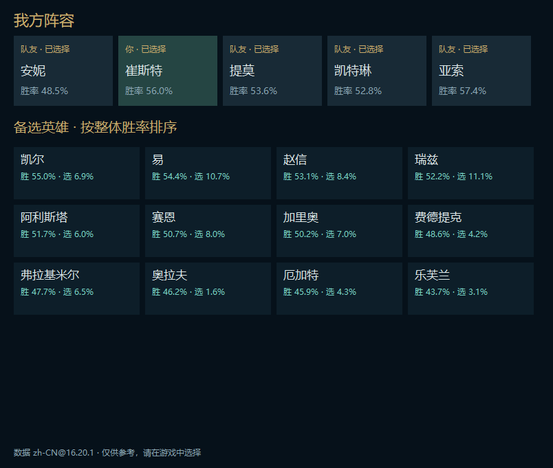
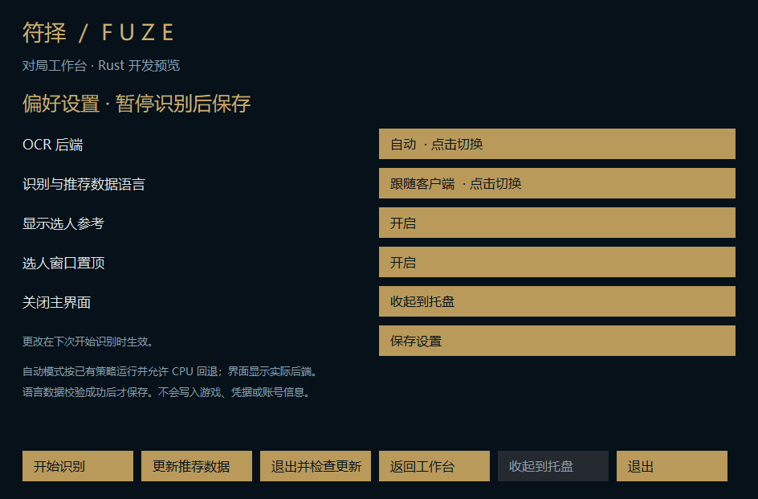

# M7a：私有更新验收与原生设置、选人参考

本阶段基于 PR #32，稳定 Electron 入口和已安装版本保持不变。仓库继续私有，整个 Rust 迁移完成后才进行公开前审查与切换。

## 实现

- 开发专用 `fuze-update-verify` 不进入玩家包；私有凭据只从匿名 stdin 管道接收，使用生产 Session、固定仓库、HTTPS、重定向去认证、Range、最终摘要校验。
- 隔离的新目录中执行实际解压、版本指针激活、原生隐藏窗口启动和重复启动。分别移走该测试副本的模型、主程序，验证健康检查失败与 CreateProcess 失败后的上一版恢复。没有调用游戏接口或捕获游戏。
- CI 保留离线解包校验，增加真实子进程安装/回滚验收。Windows CI 无私有下载凭据；私有网络结果单独记录，不能把离线 CI 叫作网络成功。
- 主界面新增原生偏好页：OCR 自动/CPU/DirectML、识别和数据语言、选人面板开关、置顶、关闭到托盘。暂停后后台校验目标语言数据，再原子保存；失败保留旧设置。开发包之外的独立用户目录保存，升级不覆盖。
- 选人面板顶部固定展示我方五人，下方备选英雄按整体胜率排列；无数据置后并显示缺失值。备选是一览卡片，不提供自动选择或换人操作。当前未添加英雄网络图标下载。
- 从已读取的 LCU 选人响应中只提取英雄 ID 与本人槽位；备选变化即使本人英雄不变也更新。断连、数据过期、暂停或离开选人阶段隐藏面板。无需额外轮询接口。
- 英雄数据使用最小 champions 范围，本地优先，只在选人需要时加载；失败 30 秒退避。不在绘制循环读取文件或请求网络，未变化时不重绘或重复排序。

## 验证边界

隐藏窗口走实际 Win32 创建、绘制、消息循环和退出路径，但离线模式禁用真实 LCU，不是玩家实战验证。故障注入仅发生于新建的隔离目录。

2026-10-15 本地真实私有频道复验通过：从 PR #31 包重建 PR #32 包，实际 Range 下载 995,526 字节；损坏差分元数据后全量回退下载 48,200,101 字节。随后隔离安装、重复启动、模型缺失回滚和主程序启动失败回滚均通过。令牌未持久化，未访问游戏。这约 97.9% 的传输节省仅适用于这两个包，不能推广到每次更新。

初轮全量验收在本机慢速单连接链路上未能在期限内完成，不能算成功。最终改为按可用字节读取、先验证 Range 支持，再最多 4 个并行的 1 MiB 分段，按原序写入后统一校验；内存缓冲约 4 MiB，限定在显式更新进程中。服务器不支持 Range 时仍可用普通全量请求。实现依据：[WinHTTP 可用字节与读取行为](https://learn.microsoft.com/en-us/windows/win32/api/winhttp/nf-winhttp-winhttpquerydataavailable)。

额外修复：新包记录 Git 构建序号，首次更新先比较解压包版本，禁止同版激活或较旧版本覆盖。此前发布的无序号开发包仍兼容读取为旧基线；它们无法提供历史时间排序，但相同 revision 始终被拒绝重复安装。

本地设置事务、备选池独立刷新、未知统计排序、并发分段顺序/长度/取消和版本保护定向测试通过。最终 Windows CI 结论见对应 PR 的 checks；不把前一提交成功当作最终提交成功。

Rust 频道内容仅为私有仓库中的开发预发布，不能自动替换正式 Electron 安装；v0.6.3 的 latest 指针保持不变。

## 原生界面预览

以下为公开英雄数据和固定测试阵容在自有隐藏窗口中的绘制，无玩家账号或实战画面。

## 后续发布门槛

1. 原生设置尚未覆盖快捷键、窗口位置/多屏记忆、全部界面语言以及旧用户设置迁移。
2. 原生选人已接阵容/备选/基础统计，完整英雄出装、符文详情、图标缓存仍待迁移；真实国服换人/备选刷新、DPI/多屏置顶需实战验证。
3. 战绩与本地个人记录页面、留存/清理、旧数据导入仍未迁移。
4. 安装发布者签名、独立信任锚、生产安装器、启动后运行健康检查、历史版本容量回收未完成；仍为手动开发更新。
5. 实际领取轮次仍未知，三卡继续整体胜率。等级、属性碎片、锻造器、刷新和弹窗消失均不作为领取证明。
6. 最终公开前再次审查当前文件、Git 历史、Actions 日志和发布资产；仅本轮更新验收通过不触发公开。
