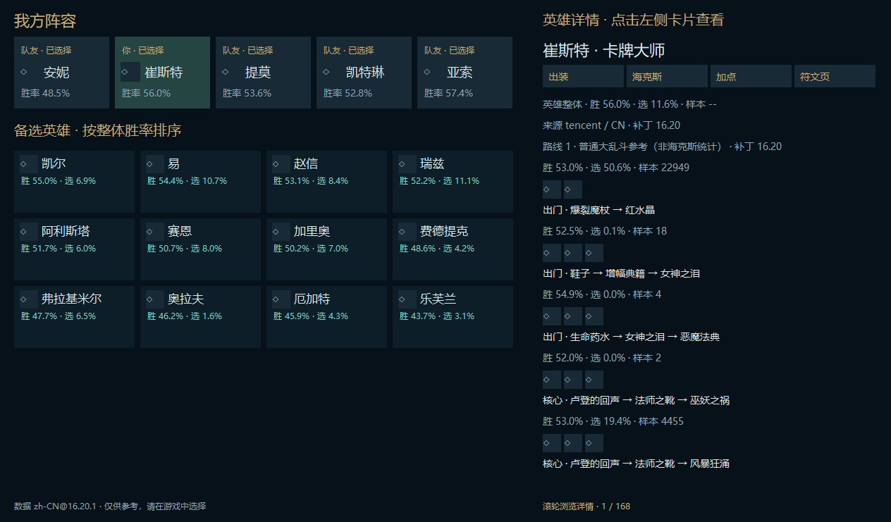
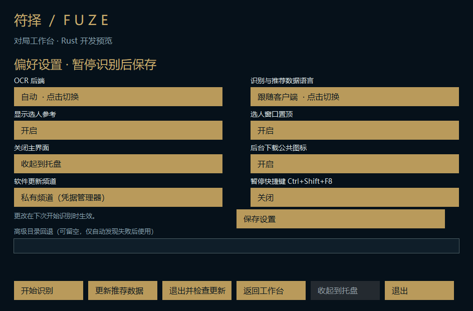

# M7b：原生英雄详情与选人资源

基于 PR #33。稳定版仍使用 Electron；仓库保持私有，不生成替代稳定版的正式安装器。

## 玩家可见变化

- 左侧保留我方五人、标记自己；备选英雄按整体胜率一览显示，备选变化独立刷新。
- 右侧默认显示自己的英雄。点击阵容/备选卡只切换参考详情，不发送选人、交换、符文页或装备写入请求。
- 本地单英雄分片接入英雄胜率、来源/版本、出门/核心/成装/条件后续装备、加点、召唤师技能及海克斯整体统计。详情支持分类跳转与滚轮浏览。
- 每个出装路线明确标注模式，后续装备标注其适用核心。缺数据保留 `--`，不伪造胜率或符文页。
- 设置增加公共图标下载、私有/公开更新频道、可选 Ctrl+Shift+F8 暂停快捷键、高级目录回退。快捷键默认关闭，被占用时提示；旧设置缺失新字段时补安全默认值。私有更新仍使用 Windows 凭据管理器，不在设置文件里保存令牌。
- 目录回退仅在进程自动发现/命令行凭据回退失败后尝试；依然绑定当前观察到的 LeagueClient PID 与存活句柄，拒绝歧义客户端，不将目录存在视为连接成功。

## 数据边界

本地 zh-CN `16.20.1` 全量静态盘点：173 个英雄、473 条出装路线全部标记队列 `450`，没有 `runes`/`perks` 符文页记录。因此显示“普通大乱斗参考（非海克斯统计）”；符文页明确显示源接口未提供。海克斯强化另列已有统计，保留其来源、地区和补丁，不混为国服同版本数据。

符文页属于源数据缺口，本轮没有凭空补一份通用页，也没有接游戏写入。实际领取轮次继续未知，三卡维持整体胜率。

## 性能与隐私

- 详情和公共图标各用一个独立工作线程；慢图标请求不会挡住新英雄的文本详情，UI 和 OCR 线程不执行图标网络、磁盘、PNG 解码。最新请求覆盖旧请求，结果按版本、英雄和请求世代接收。
- 单英雄详情按需读取，32 份内存上限；图标内存最多 192 份 48×48 BGRA（约 1.7 MiB 原始像素），每个视图最多 96 个请求。
- 固定 HTTPS `cdn.dtodo.cn/hextech/{champion,item,augment}-icons/*.png`，不接受查询串、目录穿越、任意来源或重定向，不携带 LCU/GitHub 凭据。
- PNG 最大 512 KiB，尺寸最大 512×512，解码分配受限。缓存以版本/URL 哈希命名，禁止 reparse 目录；持久缓存最多 256 文件（最大约 128 MiB），满后仍显示内存图标但不继续落盘。
- 图标缓存与设置仅在 `FuzeRustPreview` 数据目录；不接触稳定版数据。版本哈希只在缓存查询/写入边界使用，不在绘制或 OCR 帧路径反复校验。
- 关闭或离开选人取消后台资产请求、停止选人刷新计时器；无变更时不复制图标结果、不重绘。
- 关闭图标下载仍可读已有缓存。缓存不足时显示占位，不阻塞文本与统计。

## 验证与限制

- 定向 Rust 测试覆盖空统计/模式标记、旧请求拒收、图标路径策略、离线缓存读取与版本隔离、旧设置升级、无效目录拒绝及已有连接/更新边界。
- 隐藏的自有窗口读取打包的公开英雄数据，验证详情就绪、暂停/恢复/退出；不访问游戏、不移动鼠标、不读取账号/运行日志。
- Windows CI 统一执行阶段检查和打包验收。CI、自有窗口、离线夹具不能代替国服实战、多屏/DPI 或长时间性能验证。
- 公共 CDN 的在线下载耗时、断网恢复，以及手动目录在真实权限异常机器上的效果尚未实测。

## 仍未完成的迁移

1. 原生界面完整多语言、窗口位置记忆/多显示器恢复、旧 Electron 偏好迁移；当前语言选项只控制识别和数据。
2. 真实来源的符文页数据；当前源接口不提供，需单独评估来源与模式兼容性。
3. 战绩与个人记录界面、隐私/留存及旧记录迁移。
4. 原生生产安装器/发布者签名信任、启动后持续健康检查、版本容量回收。
5. 真实国服长局验证与实际领取信号验证。

以上完成并做公开前历史/资源隐私审计后，才转为公开仓库。
