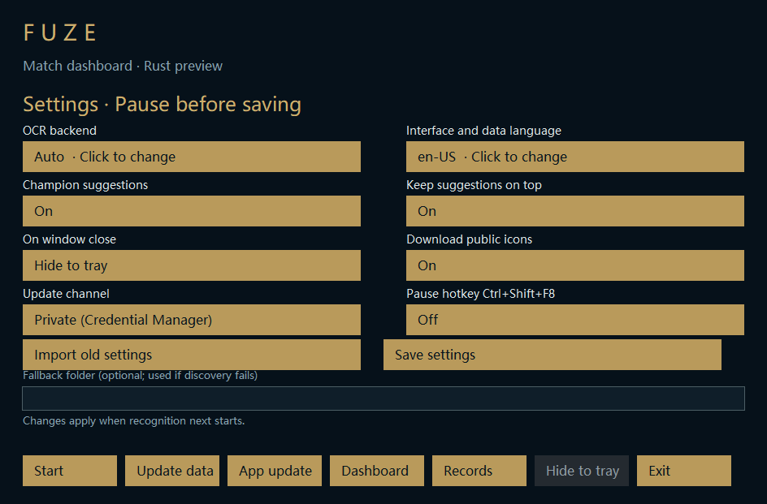
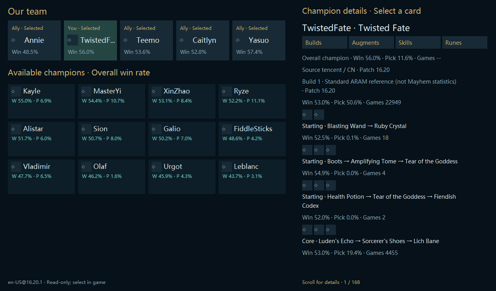
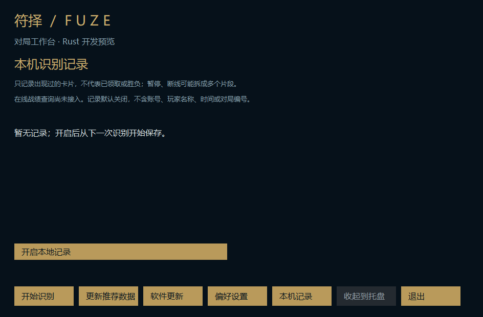

# M7c：语言、窗口连续性、偏好导入与本机观察记录

基于 PR #34 的 `70ae1bd`，该 PR 的 Windows 检查已成功。本增量仍为隔离 Rust 开发预览，不替换稳定 Electron、不合并到 master、不公开仓库。

## 已接线

- 主工作台、设置、选人概览及英雄详情、三卡浮窗支持简体中文、繁体中文、英文。显式切换先准备对应数据，再提交偏好和界面语言；自动模式等待客户端语言，并准备对应目录。数据名称保留来源原文，未知字段不伪造翻译。窗口中的版本仍明确显示。
- 主窗口和选人窗口各自记住正常窗口的位置、尺寸与 DPI。重启时按当前显示器工作区恢复；支持负坐标副屏、原显示器断开、DPI 比例变化。运行时响应显示拓扑变化，不激活窗口、不移动鼠标。最小化/最大化坐标不覆盖正常位置；目前不恢复最大化状态。
- 位置文件启动时读取；仅移动结束、显示器变化和退出等事件提交去重后的后台写入。没有帧级磁盘操作或额外图像哈希。
- 设置页提供“导入旧版设置”。用户明确选取旧 JSON 后，工作线程只读取白名单：语言、GPU 偏好、选人显示、选人置顶、目录回退。支持嵌套/点号键，冲突或错误类型拒绝。对应语言数据准备成功、目录检查成功及原子保存成功后才激活。源文件只读；令牌、账号、旧战绩、其他设置不迁移。GPU 开启映射 `auto`，不强制 DirectML。
- 新增“本机记录”页，可在暂停时开启/停止保存。默认关闭；记录已接受 OCR 的卡位 ID，保留左中右缺失槽、去除连续重复，最多 80 条/片段、100 个片段。只在片段结束/暂停/正常退出保存，不逐帧写盘。记录不含账号、玩家名、对局 ID、时间、截图、认证信息，且无网络上传。
- 记录页展示最近片段的英雄 ID、观察次数、最近三个卡位。暂停、重连及状态重建会产生独立片段，因此不把片段叫作“完整对局”，不推断领取、刷新次数或胜负。异常退出可能丢失尚未结束的片段。禁用后保留旧文件，不新增；重新启用可读回。损坏文件保留并显示固定错误，不覆盖。
- 上传检查增加原生运行目录、观察记录及窗口位置文件拦截。

## 验证

- 针对性 Rust 库测试 21 项通过：语言目录、翻译键、线程隔离、详情模式标签、位置/DPI/移除显示器、旧偏好过滤、记录缺槽/去重/上限/隐私，以及已有数据与更新边界。
- 本机 Release 编译通过；三个语言均通过隐藏自有窗口的主界面/设置/英雄详情/记录页渲染和暂停/恢复/退出验证。无游戏访问，不读取稳定版设置或个人记录。公共图标处于离线占位状态。
- Windows CI 执行一次完整阶段验收，包含既有 WGC 自有窗口、OCR、打包、更新/回滚及新增三语言桌面验证；最终状态以 PR checks 为准。
- 数学拓扑测试与自有窗口不等于物理热插拔多屏实测；实机跨 DPI 拖动、断开副屏、国服长期实战仍待用户验证。

## 仍未完成，不能视为整个迁移结束

1. 在线战绩查询、按账号隔离的个人比赛结果、旧战绩/识别记录的选择性迁移。当前记录页只提供设备本地观察片段，无法给出 KDA 或胜负。
2. 三卡浮窗的用户位置偏好、更新器等独立窗口的完整本地化，以及窗口保存失败的可见提示。
3. 源数据没有的真实符文页；当前继续明确显示未提供，不修改游戏符文。
4. 生产安装器、发布者签名信任、启动后持续健康检查、缓存/旧安装版本容量回收。
5. 真实国服实战、可靠实际领取信号及完成迁移后的公开前历史/资源审计。三卡继续整体胜率。

