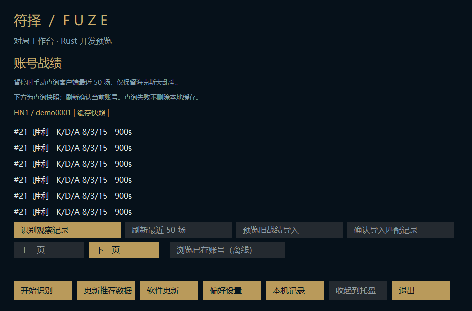

# M8: account history and selective legacy import

This increment depends on PR #35 (a9f0c0b). The stable Electron application is unchanged; the repository remains private.

## Native behavior

- The records page has separate device OCR observations and account match-history views. Observations are never retroactively assigned to an account or treated as claimed augments.
- Explicit refresh is available while recognition is paused. A background worker discovers the client, retains its process handle, verifies phase and identity, and uses the fixed loopback GET endpoint for the current summoner's latest 50 matches. Only queue 2400 is retained. This is a limited client-history source, not a complete external SGP history service.
- Routing must be reported explicitly through platform fields in the current summoner, authorization or chat response. Generic CN/TENCENT, absent routing and contradictory routing fail closed. Locale, installation path and account history do not infer a server.
- The selected participant is joined by exact PUUID and participant ID. Only match ID/time/duration, champion, KDA, outcome, item IDs and augment IDs survive normalization. Names, raw account identifiers, other players, credentials and response bodies are not persisted or logged.
- Owner/phase are verified again after querying. Failed requests keep the disk cache; cached results are returned only after re-verifying the same owner. An account switch discards the response. When the client cannot be verified, the user can explicitly browse saved accounts offline; this is labelled as a snapshot.
- Cache isolation uses SHA-256 of account plus platform, computed only for explicit history operations. The short display label is pseudonymous, not encryption. Records remain private local personal data. No upload endpoint is added.
- The isolated preview cache is limited to five accounts and 500 records each, with a 6 MiB read limit, atomic saves, duplicate game-ID merging and refusal to overwrite damaged files. New successful queries merge with older records rather than deleting history outside the latest-50 window.
- Import requires selecting the old personal-history-v1 JSON, previewing the exact current-account/platform match count, then a separate confirmation. Confirmation re-verifies the owner. Other accounts and fields are excluded; existing results win over imported duplicates. The source is read-only. Old augment journals are not imported because their observations do not prove claims or current ownership.
- Main-thread status shares immutable history rows instead of cloning all rows every 250 ms. History has no automatic refresh timer, OCR-frame writes or screenshot hashing.

## Validation and remaining boundaries

Focused tests cover explicit/conflicting platform routing, exact participant ownership, legacy account selection, cross-account/platform cache isolation, import precedence, corrupt-cache preservation, failed-query byte preservation and account-switch rejection. Hidden self-owned desktop renders exercise the history view in three locales using synthetic matches only.

Windows CI runs the existing stage suite (native build, self-owned WGC/OCR, packaging, desktop lifecycle and update rollback). Final checks must be read from the PR head, not inferred from compilation.

No real client, user history file, game input or game capture was accessed for this increment. Real Tencent LCU endpoint availability, platform fields and history response coverage remain user-validation items. No production installer or stable migration is claimed.

Remaining migration work includes richer match detail assets/date presentation, external SGP coverage if an unambiguous supported route is established, old observation-journal selective migration, independent updater localization, overlay placement preferences, production installer/signature/health/cleanup, long-running real-client validation and the final public-history audit. Actual claim stage remains unknown and recommendations continue using overall win rate.

