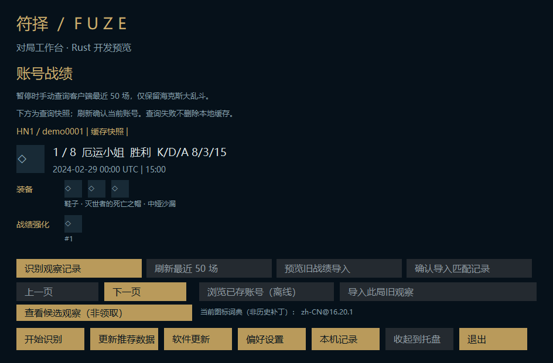
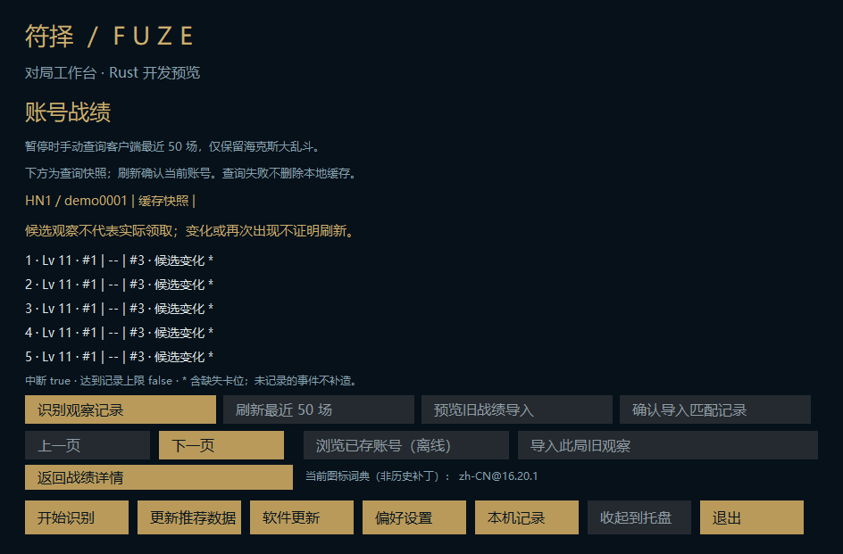

# M9: match details, public icons and selective observation migration

Depends on PR #36 at f7384ef. Stable Electron startup and repository visibility are unchanged.

## Implemented

- Native account history now shows one match per page: champion name, outcome, KDA, UTC date, duration, actual result item IDs and result augment IDs. Names and icons come from the current versioned local public catalogue; this is explicitly not the historical match patch. Unknown IDs remain visible rather than inventing assets.
- The lightweight history data scope reads only champions, items and augments. It does not load champion build shards. Prepared presentation and observation-name maps are immutable shared snapshots, rebuilt only on explicit history work or a settings change.
- Reuse the native asynchronous icon loader and allowlisted CDN paths. Download, file IO and bounded PNG decode stay off the UI/OCR threads. Requests are deduplicated and cancelled on page changes, hiding, or recognition start. History icons are active only on the visible detail page while paused. Download-disabled mode still permits local cached icons. Source failure leaves placeholders and result text.
- Select a saved match, then explicitly choose the old augment-journal JSON. Preview only the currently verified account/platform and selected game ID; a separate confirmation re-verifies the current account before storing. An existing personal match for that exact owner is required. No directory scan, raw-log upload or automatic import.
- Imported observations are stored separately from result augments, account-isolated in the existing preview cache. Three left/centre/right candidate slots, missing positions, level hints, first/changed/reappeared kinds, incomplete-session and capped flags survive. Names, raw account IDs, timestamps and other arbitrary source fields are omitted.
- The viewer explicitly says observations are not claims and changes/reappearance do not prove rerolls. It does not derive an actual claim stage, choose a card, backfill missing observations, or change overall-win-rate recommendations.
- At most 100 observation sessions per account, 80 events per session; source reads are bounded to 4 MiB. Cache reads remain bounded to 6 MiB. Reimporting the same match is a no-op and does not overwrite earlier confirmed observations. Subsequent result refreshes and legacy-result imports preserve observation data. Anonymous native OCR records stay separate.

## Validation

Local affected-crate tests cover the restricted display scope, UTC dates, unknown IDs, icon URL/cache/decoder boundaries, owner/game filtering, preserved missing slots, ignored claim-like fields, idempotent import and refresh preservation. Three-language hidden self-owned render checks use synthetic result/observation records plus bundled public dictionaries. Icons are intentionally offline placeholders in those screenshots; they are not evidence of a live CDN download.

Windows stage CI runs the existing native build, own-window WGC/OCR, desktop/tray lifecycle, packaging, private updater and rollback checks. The PR's final checks identify the validated head.

No real client, game capture, installed configuration or personal history/log was accessed. Real Tencent history availability and long-running game behavior remain unverified. No stable installer is published.

## Remaining migration boundaries

External SGP coverage still needs an unambiguous supported route. Independent updater localization, overlay position preferences, production installer/signature/health/cleanup, long-running real-game acceptance and the pre-publication privacy/license/history audit remain. Entire migration is not complete; the repository remains private.

