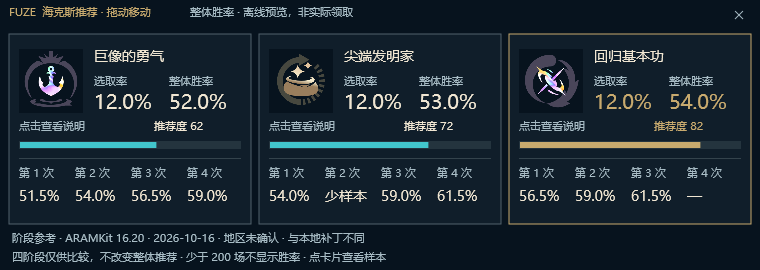
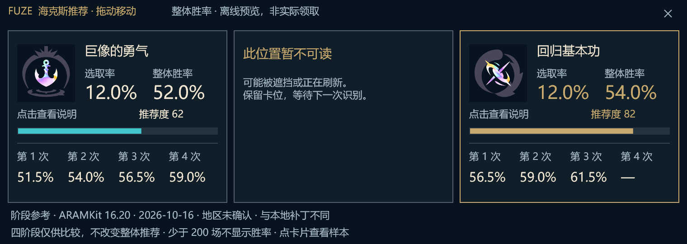

# Rust 三卡阶段参考与识别调度

本批次范围：三张候选卡直接显示第 1–4 次的公开胜率参考，修复等级调度和手动参考窗口的遗漏。实际领取仍为 Unknown，推荐度、金色推荐框、整体胜率和左右卡位继续由原整体数据决定。本批次不打包、不替换已安装程序。

## 为什么过去看不到自动分阶段推荐

数据已经有接口和缓存，但 Rust 生产链路只把整体推荐送入三卡 Publisher；阶段参考停留在英雄详情手动面板。ActualStage 只有 Unknown，识别结果也始终 selection_confirmed=false。没有一个已经实现、只待开启的自动阶段排序开关。

另一个独立问题：旧等级调度依赖 Augment → Absent 才结束待选窗口，但生产 OCR 只产生 Candidate / StatShard / Unknown。结果是正式选择结束后仍可能持续采用 250 ms 间隔。不能通过伪造“领取完成”来修复调度。

## 玩家现在会看到什么

- 每张已识别卡下方并排显示第 1、2、3、4 次胜率，不要求玩家操作列表。
- 200 场及以上显示胜率；不足显示“少样本”；缺失显示“—”，从不借用整体值。200 是显示门槛，不是统计显著性保证。
- 被遮挡的位置继续保留原卡位和不可读提示，不把其他位置的符文搬过来。
- 公共脚注明示 ARAMKit、补丁、数据日期、地区未确认；与本地推荐数据补丁不同或缓存待刷新时提示。
- 点卡片沿用原说明展开区域，附带四阶段场次。页面没有“当前第几次”的假定高亮。
- 原英雄详情手动参考仍保留，补充地区与补丁提示。收起/关闭会取消自己的请求并清空状态；局内刷新按钮显示“对局中仅读取缓存”。

隐藏原生窗口渲染，数值为合成夹具，不代表真实符文胜率：

## 缓存、网络和性能

选人阶段本人英雄稳定 750 ms 后，或进入加载阶段，准备当前英雄的公开统计。加载阶段可沿用最后验证的选人英雄；进入对局必须再次采用宿主当前英雄。不会预抓全英雄。

三卡与两个英雄资料窗口共享一个缓存、下载锁和冷却。缓存最多 8 个英雄、2 MiB；6 小时内准备请求直接复用，7 天后不再展示；失败保留有效旧缓存。30 秒下载间隔，网络失败冷却 5 分钟；自动准备只在排队冷却结束时重试，真正网络失败不自动重试。

对局中只读缓存。进入对局或暂停后撤销下载资格；代次变化让旧请求在下一取消检查处失效。已进入系统调用的传输不承诺瞬时终止，但不能继续启动下一数据请求。UI 查看内存缓存采用 try_lock，不等待磁盘或网络锁。

阶段对照仅在英雄、三张 ID、数据版本、源缓存或过期状态变化时重新生成。重复宿主更新复用 Arc，不重复解析整表、哈希、解码图标或重绘三卡。不新增定时器、进程扫描、游戏接口或 OCR 调用。

固定 HTTPS 源只携带公开英雄 ID；不发送账号、战绩、截图或认证。测试使用合成数据，不读取玩家缓存。现有严格格式校验、大小限制和更新失败保留缓存均保留。

## 等级调度修复

等级仍只用于调度：

- 接近或跨过 3/7/11/15 级阈值时，最多先加速 20 秒；同等级遥测不能无限续期。
- Candidate 或 StatShard 可保持快速检测；没有新选择画面证据 6 秒后恢复兜底检测。
- 有新鲜等级时兜底间隔 1000 ms；等级失效为 1500 ms；1 级低频为 8000 ms。
- 属性碎片、刷新短暂空白、延迟领取之后重新出现候选卡，仍能重新进入快速检测。
- 不存在 finished_windows 或“观察结束即领取”的计数。

这些数值是任务调度间隔，不是游戏内端到端延迟或 CPU 降幅的实测承诺。

## 自动按当前轮次显示：下一步的接口边界

1. 统计适配器只负责 Source / Patch / Date / Champion / Stage / Samples，不提供领取结论。
2. 新的只读轮次适配器必须提供本人、本局、当前候选正式奖励身份、正式序号 1–4、时间与上下文代次。不能只提供已领取数量。
3. 自动展示/排序只能消费经过上述验证的当前候选正式序号。换英雄、重连、刷新后的陈旧响应、源补丁不匹配、低样本或未知奖励类型必须回退整体；具体排序策略需单独实现与验收。
4. 阶段参考始终可以同时显示四列，不依赖上述适配器，因此这批可以独立验证。

必须覆盖正常四次、同轮多次刷新、碎片、连续锻造器、特殊强化额外选择、积攒后先碎片再正式选择、中途启动、断线重连、新对局。现有手动诊断只认识少量候选字段和事件名，HTTP 成功或某个计数变化都不证明语义。

研究依据：

- [ARAMKit 阶段说明](https://aramkit.com/en-US/blog/augment-rarity-and-stages)：阈值与实际弹出/领取有时间差，阶段统计不是因果收益保证。
- [Riot Game Client API](https://developer.riotgames.com/docs/lol#game-client-api)：文档公开示例未给出可直接依赖的国服海克斯正式轮次；这也不证明实际客户端一定不支持。
- [Overwolf Arena 游戏事件](https://dev.overwolf.com/ow-native/live-game-data-gep/supported-games/league-of-legends-arena/)：区分候选 augments 与 picked_augment。它是 Arena 的 SDK 能力，不能冒充国服海克斯大乱斗 LCU 的只读能力；本批不引入该 SDK，不读取游戏内存或注入。

## 开发验收范围

### 游戏进程访问边界

原生捕获发现先通过 `TH32CS_SNAPPROCESS` 获取进程名和 PID，仅允许 `League of Legends.exe` 候选进入窗口路径校验。对候选仍核对已认证客户端根目录下的实际文件路径、窗口 PID 和进程存活；同名进程不等于可信目标。快照失败返回原有发现错误，不恢复对其他窗口所属进程的路径查询。

候选句柄仅申请 `PROCESS_QUERY_LIMITED_INFORMATION | PROCESS_SYNCHRONIZE`，用于可执行文件路径查询和存活等待；不申请 `PROCESS_VM_READ`、`PROCESS_VM_WRITE`、`PROCESS_VM_OPERATION`、创建线程或调试权限。句柄不可用时保留失败状态，不提权或改用内存读取。快照只在捕获建立/恢复的既有退避流程运行，捕获存在时不新增扫描。

LCU 发现同样只查询已筛选的客户端进程；命令行回退使用限定客户端 PID 的 WMI，不读取 PEB 或其他进程内存。WGC 取得的纹理及 OCR 输入属于本程序捕获缓冲区；`GraphicsCapture.dll` 从 System32 加载并固定在 FUZE 进程内。运行开销只采样宿主及其持有的 OCR 子进程句柄，没有查询游戏内存占用。

本批 Rust 自有源码检索及调用点复核未发现进程内存读写、注入、游戏 Hook、驱动访问或调试提权路径。这是实现边界复核，不是第三方二进制完整审计，也不代表反作弊兼容认证。后续实际轮次不能通过这些途径补齐。

依据：[Windows 进程权限](https://learn.microsoft.com/en-us/windows/win32/procthread/process-security-and-access-rights)、[进程快照的标志与生命周期](https://learn.microsoft.com/en-us/windows/win32/api/tlhelp32/nf-tlhelp32-createtoolhelp32snapshot)。新增一项合成元数据用例覆盖客户端排除、大小写、相似文件名、无效 PID 和字符串结束符；本机定向编译/测试通过，没有扫描实际游戏进程或采集画面。

### 阶段显示与调度验证

定向验证等级调度、取消/上下文切换、共享缓存、低样本/缺失/过期处理、卡位和整体分数不变。隐藏自有窗口使用合成数据检查五种 DPI 的三卡与阶段面板、说明命中区域、重复数据不重绘。

2026-10-17 本机结果：18 项定向库/投影测试通过；Release gpu,ui-audit 构建通过；618 项双尺寸组件检查通过（包含重复尺寸与状态，不是 618 个独立按钮）；隐藏宿主联动通过。已实际检查 96/192 DPI 完整与遮挡三卡、样本说明、420 像素宽阶段面板与补丁差异提示，五档 DPI 渲染全部完成。宿主缩窄请求后的输出仍为 420 像素，因此不计作 380 像素原生渲染验收。重复阶段更新没有增加重绘；Direct2D 隐藏窗口空闲 0 次绘制，前台窗口未改变。工作流 YAML、格式、差异检查通过，1107 个 Git 索引文件的隐私扫描无发现。

初次组件检查的 4 项失败来自通用脚本重复激活收起按钮却仍期望收起；按开/关状态分别验证后通过。没有把失败隐去或跳过实际取消路径。

隐藏渲染不等于真实对局性能、跨屏输入或领取轮次实测。没有自动领取判断、没有阶段排序开启、没有新正式安装包。
