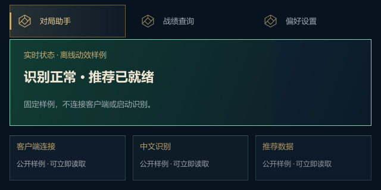
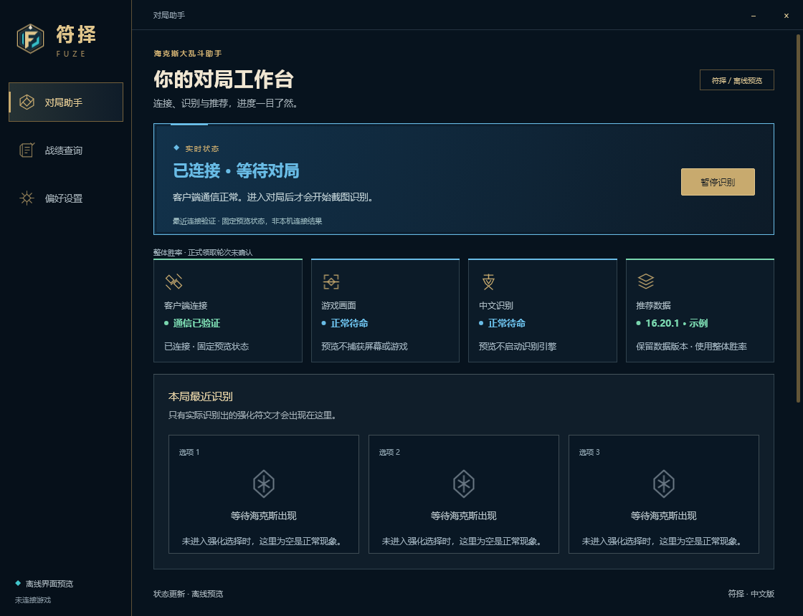
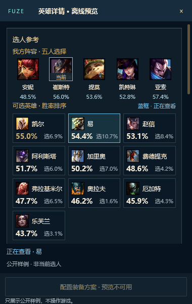

# 中文工作台与浮窗打磨

本批次保留 v0.6.3 的中文导航、顶部状态、四模块和三卡结构，以及已经确认的“五人阵容＋候选英雄网格”。没有增加业务功能或更换 UI 框架。

## 变化

- 常读说明提升到 12px，默认正文 13px。普通面板使用低强调边线，金色保留给品牌、主要操作和重点数据。
- 按钮补按下反馈；正在执行的查询、目录保存、数据更新、导出与装备配置保持文字清晰，同时禁止重复触发。
- 操作反馈使用固定高度的底部区域，不再改变内容区高度；长提示可滚动，错误不会被自动计时隐藏。
- 选人窗口保留五人阵容和候选网格：金色标识当前英雄和领先胜率，蓝色边框表示正在查看，浅色内框表示键盘焦点。底部持续说明正在查看的对象。
- 按钮采用 100ms 反馈，导航背景、金色选中标记和图标采用 180ms 淡入淡出，开关保持 160ms。键盘焦点边框立即可见。
- 顶部状态背景由左向右铺展 280ms，使用 cubic-bezier(0.22, 0.8, 0.25, 1)，前 70ms 约完成 73%。文字、错误边框和按钮立即更新；相同状态不重播，中途新状态直接覆盖，不排队。结束后移除临时颜色层。
- 首页四模块、最近识别区，以及设置/战绩首屏面板首次访问时分组显现，组间 30ms，总时长最多 256ms（含一次 16ms 调度）。内容从 84% 不透明度开始，位置与交互始终可用；返回页面和重新获得焦点不重播。状态区、局内三卡及长列表没有出场等待。
- 主窗口采用 DWM 普通圆角，选人、次级资料和三卡窗口采用小圆角。系统不支持时回退为静态窗口区域，按 DPI 计算主窗口 8 DIP、浮窗 4 DIP，只在尺寸/DPI 事件更新；最大化撤去自定义区域。没有引入透明分层窗口。

## 动效边界

仅在 GPU 会话、窗口获得焦点、Windows 允许客户区动画且非远程桌面时启用。失去焦点或被遮蔽后关闭；系统偏好在重新获得焦点时读取。软件渲染回退与默认隔离预览静态显示。

没有新增轮询线程、持续帧循环、运行时图片资源或第三方依赖。两个短时启动计时器只运行一次，结束后停止。既有原生窗口事件负责更新开关；隐藏到托盘时主动终止动效。Direct2D 三卡只增加外轮廓圆角，保留即时显示、事件驱动绘制和过期撤下逻辑。

## 验证范围

- Release 构建，包含 GPU 和隔离 UI 检查入口。
- 真实隐藏组件的宽/窄窗口事件路由、禁用态、键盘操作和确认框，额外检查反馈不会改变内容区高度。
- 100%–200% 离屏缩放图、有限动画结束、重复状态更新不延长动画、关闭动效后立即切换、静止界面无额外重绘。
- 自有隐藏 Direct2D 窗口保持不激活、空闲不持续绘制。上述测试不代表真实游戏帧率、跨屏或实机输入法验收。

验证只使用公开样例和隔离配置，不访问游戏或客户端，不模拟系统鼠标键盘，不读取个人数据。没有打包、安装、替换稳定版或发布 Release。

前一批次已通过 Release 构建、614 项组件交互、隔离宿主及六组离屏尺寸/缩放检查。软件离屏完整重绘仍较慢，生产软件回退不启用过渡动画。

本次增加可控时间的真实 Slint 组件检查：颜色方向、曲线、中断、重复通知、禁用动效、返回页面和空闲重绘。Windows 隐藏窗口检查读取 DWM 圆角偏好，并实际验证区域回退的边缘与缩放后几何；不能把属性读回解释为已验证桌面合成后的圆角边缘。GPU 检查使用自有隐藏 Skia 表面，不是实战帧率或屏幕显示延迟。

2026-10-17 本轮最终检查：Release（gpu,ui-audit）、614 项控件交互、动效检查及六组离屏尺寸/缩放全部通过。动效关闭时包括导航在内立即停止，静止界面额外重绘为 0。RTX 3060 Ti 的隐藏 Skia 动效样本 71 帧，绘制并等待 GPU 完成中位数 2.12ms、P95 3.14ms；隐藏 Direct2D 窗口绘制中位数 0.50ms、P95 1.00ms，空闲绘制 0，前台窗口未改变。实体跨屏、远程重连及可见 DWM 圆角边缘仍需实机验证。

