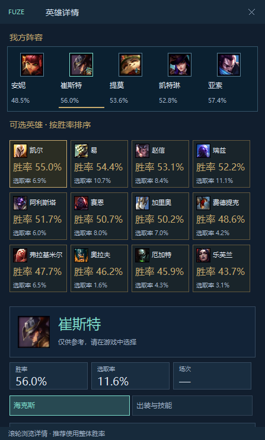
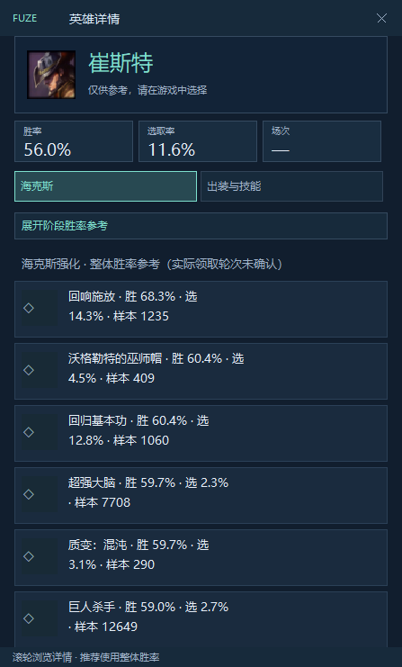
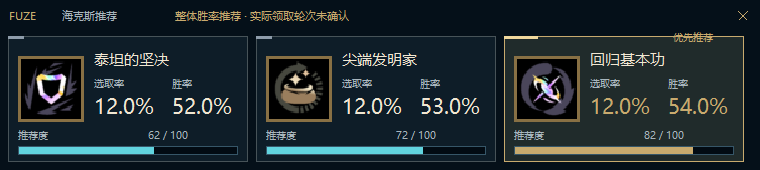
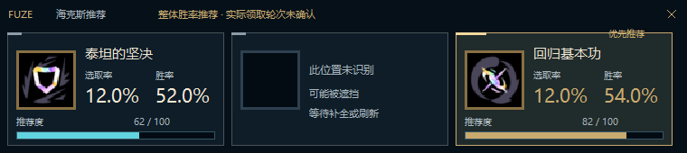

# 中文选人与局内浮窗复原

基准是迁移前仍保留的 Vue 组件，不以 Rust 双栏功能原型为设计基准。Rust 宿主、只读连接和识别流程继续保留，未替换本机稳定版。

## 逐项对照

| 原版来源与结构 | 原生实现 | 说明 |
| --- | --- | --- |
| `AugmentWinrateOverlay.vue`：FUZE / 英雄详情标题栏，纵向内容 | `champ_presentation.rs`：同顺序的标题、我方、备选、英雄、统计、详情 | 移除原型的左右双栏与系统标题重复显示；标题栏可拖动、关闭，保留缩放、置顶与位置记忆 |
| `AramBenchRecommendation.vue`：我方五人，当前玩家标记 | 顶部固定五个位置；本人的图标边框与标记为青色 | 保留团队顺序；查看其他英雄不等于在游戏中选择 |
| 同组件：备选按整体胜率排序，金色卡片平铺 | 响应式 3–8 列一览；空白缝隙不命中相邻英雄 | 与上方蓝色我方阵容区分；不增加翻页、横向轮播或需要逐个切换才能看胜率的列表 |
| 英雄大图标、姓名、胜率 / 选取率 / 场次 | 复用英雄图标；三个统计格；缺少场次显示破折号 | 不把空值变成零、不使用推算场次 |
| 海克斯 / 出装两个主标签 | 海克斯 / 出装与技能两个标签 | 出装、加点、召唤师技能及符文数据缺失说明都可达；阶段参考放回海克斯区域的展开项 |
| `AugmentFloatingOverlay.vue`：760×170，三个固定卡位 | 左侧 66px 图标，右侧并排选取率 / 胜率，底部 9px 推荐轨道 | 不显示左上角卡号和数据版本；保持整体胜率及领取轮次未知提示 |
| 缺失卡位原位提示 | 显示“此位置未识别 / 可能被遮挡 / 等待补全或刷新” | “可能”不等于已经证实遮挡；不挪动其余两张卡 |
| 局内次级面板：深蓝、青色标题、带图标条目 | 同一标题栏、深蓝条目、图标与正文间距 | 与三卡识别独立；不推断实际领取 |

颜色直接取自旧组件：海克斯三卡采用海克斯科技深蓝与古金；英雄详情采用旧版 `#111e2e` / `#172a3b` 底色、`#7ddfcd` 青色与金色备选卡。继续使用微软雅黑系统字形。原生 GDI 与浏览器的字体栅格、圆角、阴影不同，本次是结构和视觉角色逐项复原，不声称像素完全相同。

## 资源与性能

- 复用原推荐数据的英雄、装备、海克斯图标地址和既有有界缓存；不新造图标，不把通用符文图片冒充海克斯图标。
- 图标缺失时保留占位；推荐文字不等待图片。下载开关继续有效。
- 图标下载和 PNG 解码由既有后台工作器处理，传给浮窗的最多三张 48×48 BGRA；同一组候选不重复请求。
- 美术结果使用独立、仅保留最新值的有界邮箱，不挤占识别结果队列，不等待窗口确认。无图标目录时不创建美术工作器。
- 每次绘制只读取当前三张卡的统计，避免复制完整英雄强化表；没有新增截图、OCR、游戏 API、散列轮询或动画循环。
- 三卡关闭按钮隐藏当前候选，而不销毁识别宿主持有的窗口；候选变化或会话重置后可再显示。
- 默认中文界面不跟随自动探测的数据语言切换；明确的繁中/英文偏好仍受支持。

## 验证与边界

- 定向验证团队/备选命中区域、排序和语言目录；不为纯样式增加大量重复测试。
- `--desktop-smoke` 使用公开数据、隐藏自有窗口，检查启动/暂停/继续/退出；`FUZE_POPUP_REVIEW` 额外验证滚动后的标签命中、窄窗口、详情、阶段参考和局内面板。
- `scripts/preview-popup-restoration.mjs` 直接渲染保留的 Vue 组件作为对照。仅下载固定公开 CDN 的有界美术样本，浏览器页面阻断网络；不读取安装版缓存、日志或账号。
- `--smoke` 的可选 `FUZE_OVERLAY_REVIEW` 使用显式合成胜率和公开图标，检查三卡实际 GDI 输出、关闭不销毁窗口、隐藏/不抢焦点状态。示例胜率不是实战结果。
- PR #46 的 Windows 编译和隐藏窗口检查通过，但 CI 专用 WGC 集成步骤失败，只输出 `host-failed`；补充固定错误类型白名单以保留故障分类，不输出原始异常或私人上下文。需由新 CI 核实，不将隐藏窗口验证当成真实 WGC 成功。
- 未操控鼠标、游戏、安装版 FUZE；未进行真实对局、物理多屏或领取轮次验证。继续使用整体胜率。
- 与原版功能仍有明确边界：不写入游戏符文/出装；数据源缺少符文页时仍如实说明。原版稀有度筛选、描述悬停和攻略外链没有在本次补写为新业务功能，不能把视觉复原说成所有原版能力均已完成。

## 渲染证据

