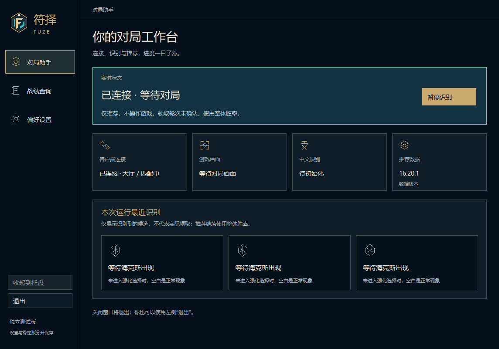
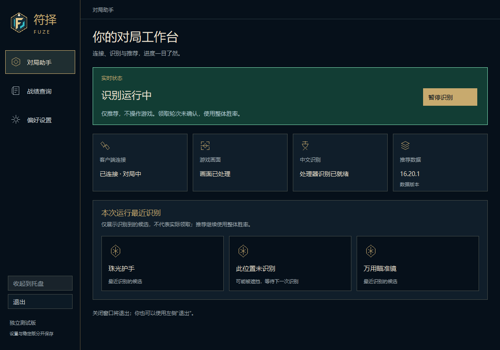
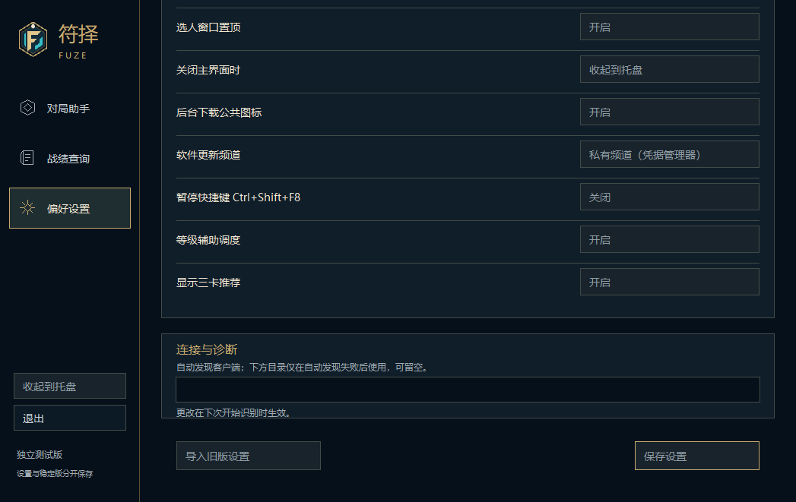

# 中文工作台复原

设计基准是 Rust 迁移前的 FUZE，而非 Rust 功能原型。参照 `d26bb2f` 中仍保留的 `src/renderer/components/Display.vue`、`RuneGlyph.vue` 和 `styles/workbench.css`。保留 Rust 宿主和现有业务流程，不回退到 Electron，也不替换本机稳定版。

## 审查结论与优先级

| 优先级 | 偏差 | 本轮处理 |
| --- | --- | --- |
| P1 | 原型把左侧导航改成底部七个按钮 | 恢复左侧对局助手、战绩查询、偏好设置；暂停在状态区，更新在设置页 |
| P1 | 四个模块成为两行，缺少最近三卡区域 | 恢复横排模块与三张候选卡；推荐数据保留实际版本号 |
| P1 | 绘制与控件使用不同的高度缩放 | 绘制和控件共用 DPI/滚动坐标；窗口较矮时滚动，不纵向挤压 |
| P1 | 数据语言变化可能使默认中文界面切换语言 | 自动数据模式保留简体中文主界面；明确选择其他语言时继续支持 |
| P2 | 所有原生按钮都用金色，主次不清 | 金色用于主要操作与选中导航；其余采用原版深色与细边线 |
| P2 | 设置项是原型按钮网格 | 恢复分组行式设置；更新、设置、连接诊断、导入和保存分区 |
| P2 | 工程语言和语言代码出现在设置值 | 改为处理器、显卡加速、简体中文、繁体中文、英语等用户文案 |
| P2 | 低分辨率下目录和保存控件可能不可达 | 页面滚动、原生滚动条、键盘焦点自动滚入视野 |

深蓝底色、古金强调色、象牙白正文、青色正常状态和原有 FUZE 标识均保留。图形沿用 RuneGlyph 的线条路径，以原生绘制复现；不引入字体、图标下载、网页容器或动画循环。

## 行为边界

- 最近三卡只使用本次会话的候选观察；属性碎片、未知画面与全空帧不会覆盖最近有效候选。保持左、中、右位置，未读位置明确提示可能遮挡。
- 会话清理、暂停、断线导致的流水线清理会清空三卡内存。仅在内存中保留三槽位，不读取旧日志，也不把观察当作实际领取。
- 实际领取轮次仍未确认；推荐继续使用整体胜率。
- 选人、局内浮窗、更新安装与战绩查询的业务契约保持不变。本轮恢复主界面与设置外壳，不声称已逐像素还原所有旧版弹窗或完成所有旧版功能迁移。
- UI 按已有状态发布刷新；没有新增截图、OCR、游戏接口或远程数据轮询。控件整体布局只在导航、尺寸或滚动变化时更新。

## 验证

- Rust release 构建；现有语言目录唯一性、完整性和线程隔离测试。
- 隐藏原生窗口的真实 GDI/子控件绘制：简体中文主界面、设置、战绩、选人、部分卡位、暂停、错误状态和较小窗口。
- `--desktop-smoke` 验证启动、暂停、继续、退出，以及 `game_access=false`。
- `FUZE_WORKBENCH_REVIEW` 仅在显式离线 smoke 模式执行；验证导航回调、滚动范围和目录控件可见边界。已接入现有 Windows CI 的桌面检查，无第二套大规模测试。
- 图片使用公开数据或合成状态，不含真实账号、日志、令牌、认证地址或对局记录。
- 未进行真实对局、物理多屏或跨 DPI 拖动实测；不据此宣称游戏性能、在线发现或领取识别已通过。

## 界面证据

