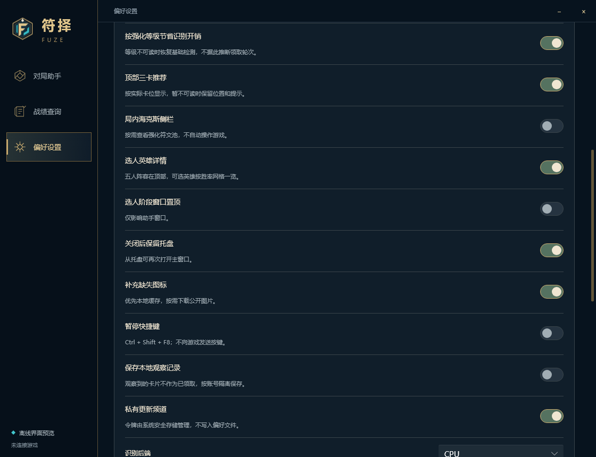
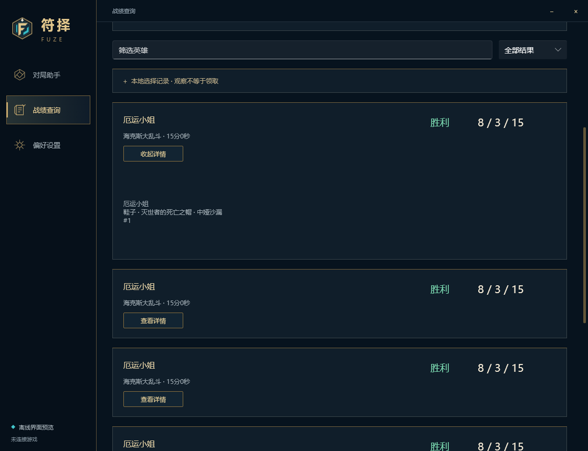
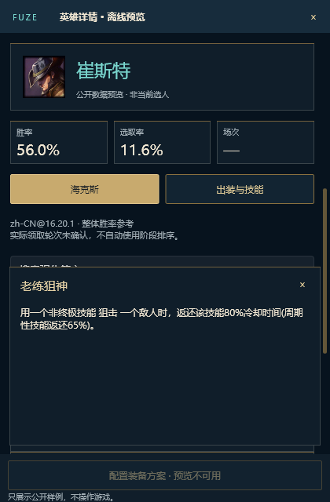
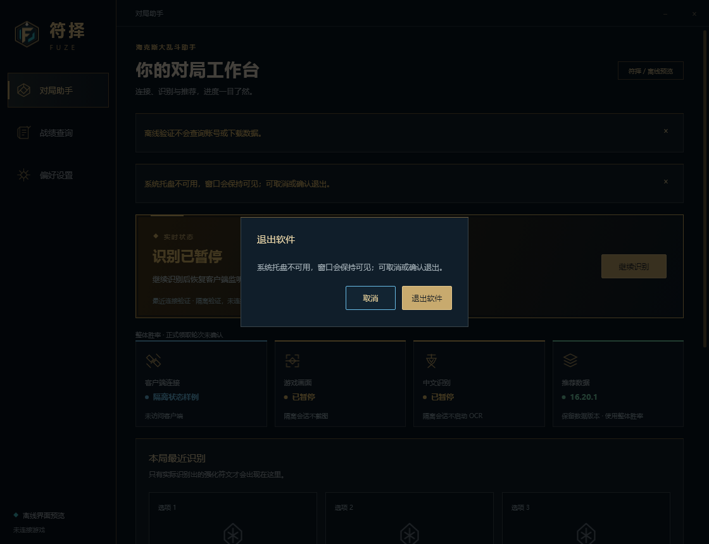

# Slint 与已有 Rust 服务接线进度

基准：`v0.6.3 / 58aea5e`。本批接在 PR #51 后，仍是隔离开发分支，**未达到完整功能与交互一致性，不发安装包、不替换稳定版、不要求玩家验收**。

## 本批可验证的变化

- 通过 `desktop::frontend::Session` 复用原 Rust 引擎；Slint 没有另起一套 LCU、截图、OCR 或设置存储实现。原 Win32 入口保持不变。
- 首页使用宿主状态、数据版本、三卡固定卡位、资源和等级信息；离线入口明确标注隔离样例。没有运行 OCR 时不伪造识别成功。
- 设置开关、识别后端和手动回退目录经宿主校验/提交；忙碌期间禁用重复提交，失败保留原值。这里只验证隔离会话应用；磁盘写入另由已有偏好测试覆盖，不能当成已验证生产会话。
- 战绩由已有账号隔离 View 提供，支持英雄/结果筛选、六条分页、展开详情、未提供数据和失败说明。查询入口仍有暂停/离线边界，离线验证拒绝网络查询。
- 英雄详情使用已有 `fuze-data` 解析器；补入搜索、稀有度、梯队、右侧大号胜率、说明、出装路线、装备/召唤师技能图标和等级加点格。普通大乱斗数据保留其原模式标注，不冒充海克斯专属统计。
- 五人阵容与候选网格整批替换，结束/失效时清空；自己的英雄变化后重新跟随，检查候选不会操作游戏。连续切换英雄只接受最新请求，清空后旧请求也不能重新发布。
- 图片来自此前已有公共缓存；后台读取/解码，固定路径映射，18 个重复文件改为引用现有资源。英雄详情缓存上限 8 份，图片解码缓存上限 128 项。详情就绪后停止等待定时器；筛选和页面绘制不读盘、不联网、不执行哈希校验。
- 原色板、侧栏、首页层级和自绘滚动条保留；加入滚动条拖动、候选与阵容的键盘焦点，输入框统一深色。

## 开发侧验证

- `cargo build --release --features gpu --locked --offline`：隔离 Slint 二进制构建，无安装包。
- `--review-host`：隐藏的自有 Winit 窗口，1120×860 主界面与420×640详情窗口；直接调用组件回调，不模拟输入。检查设置提交、无效目录保留、暂停恢复、战绩详情/分页/筛选、最新英雄结果、候选替换/清空及空闲定时器停止。
- 同一检查分别读取明确指定的公共数据目录与纯合成 CI 数据；CI 不依赖线上数据站或本机账号。
- 现有偏好/旧设置迁移相关 3 个测试：保存失败保留原文件、白名单和默认值验证。
- 图像是原生隐藏窗口的栅格快照。不能证明可见浮窗置顶、真实中文输入法、跨显示器或游戏帧率。

## 尚未达到基准的范围（保留为发布阻断项）

后续浮窗接线与阶段参考进度见 [LIVE_OVERLAYS.md](LIVE_OVERLAYS.md)，以下表格为本批交付时的边界。

| 范围 | 当前边界 / 下一项 |
|---|---|
| 产品启动与窗口 | 主窗口托盘、暂停热键、退出确认和位置记忆已接线，见下方验证边界。新 Slint 仍由隔离入口启动；单实例、生产启动健康协议、选人/局内窗口生命周期仍未完成。 |
| 更新与存储 | 原 Rust 已有差分、全量回退、令牌管理、回滚与存储逻辑；Slint 更新/存储面板仍未完成真实操作/进度/确认接线，相关按钮保持禁用。 |
| 语言 | 简体中文优先；全量界面文案和数据激活事务未完成前禁用语言切换，避免半中文界面。 |
| 战绩与个人记录 | 查询错误与缓存基础契约已复用；图片分享、完整图标展示、选择性旧数据迁移、观察记录详情尚需迁入新页面。 |
| 选人详情 | 还需攻略跳转、分阶段手动参考、配置装备方案确认/反馈、完整图标动态缓存及窗口置顶生命周期。不能把只读预览当作配置装备成功。 |
| 三卡与侧栏 | 上轮 Direct2D 渲染仍是独立原型；实时宿主模型、刷新保留、关闭状态、次级面板、完整说明需接入同一窗口生命周期。 |
| 可访问性与真实窗口 | 模态焦点、键盘全路径、中文 IME、混合 DPI、远程桌面恢复需继续核对。 |

实际领取轮次仍未确认，自动推荐继续整体胜率。不得把观察、刷新、等级或属性碎片当成领取信号。

本批无游戏接口请求、鼠标/键盘模拟、个人日志/战绩读取、稳定版重启、安装、Release 或仓库公开操作。

## 本批画面与记录

[隔离回调验证记录](host-interactions/host-review.json)。此外，Skia 软件光栅隐藏窗口验证完成1120/920宽度与真实尺寸事件，12帧热快照中位数4.20ms、P95 5.55ms；这不是GPU或实战性能。

## 继续推进：主窗口生命周期与状态准确性

- 标题栏关闭与系统关闭统一处理：托盘可用且启用关闭到托盘时隐藏；托盘不可用时保留中文退出确认，防止窗口消失后无法恢复。
- 托盘提供打开、隐藏、暂停/继续和退出；退出需要主窗口确认。复用品牌 ICO。Explorer 重启后重新登记；登记失败时将隐藏的主窗口无激活恢复到任务栏，由玩家自行打开，不调用游戏或输入接口。
- 暂停热键仅在偏好启用时登记，冲突会在设置页显示中文说明。切换关闭时释放，退出时清理。单击与双击托盘去重，避免双击打开后又隐藏。
- 托盘与热键复用宿主状态变化通知，没有额外重复轮询。窗口位置复用 `window_memory`，移动/缩放合并到 500ms 后后台写入，退出前刷新末次位置；隔离模式不读写个人位置文件。
- 退出确认默认焦点在“取消”，Tab/Shift+Tab 留在两按钮之间，Escape 取消；确认后请求原宿主停止，再退出事件循环。主窗口隐藏后事件循环继续，不能因最后一个窗口隐藏而意外退出。
- 首页分别映射连接、截图与 OCR 状态：区分认证失败、大厅、选人、加载、局内、赛后和暂停。旧卡片不能覆盖连接失败；等待游戏窗口不报成截图成功或 OCR 故障。推荐数据版本继续显示，实际领取轮次未知时保持整体胜率。

新增定向验证：状态映射中的认证失败/旧卡片/大厅/局内/游戏窗口等待/截图异常；隐藏窗口的关闭退路、取消、取消按钮焦点、退出回调和宿主停止完成。使用合成数据，系统托盘登记和全局快捷键保持禁用，主窗口与消息窗口均隐藏，前台窗口保持不变。

这证明组件回调和隐藏原生窗口链路；**不证明实际托盘点击、Explorer 重启、全局热键冲突、真实键盘导航或跨屏恢复已经通过玩家验收**。窗口记忆的算法复用已有实现，本批没有读取或改写用户位置文件。

