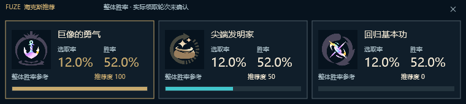
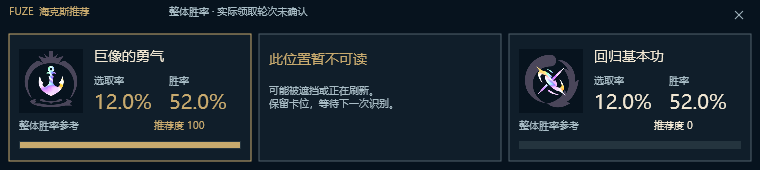
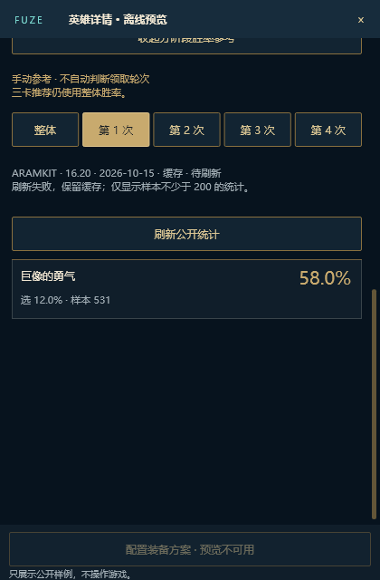

# Slint 浮窗宿主接线与手动阶段参考

基准仍为 v0.6.3，保留已确认的“五人阵容＋候选英雄网格”改动。本批在 PR #52 上继续开发，属于隔离开发入口；不是安装包，也不表示完整迁移已通过验收。

## 本批实现

- 现有截图/OCR 管线经过属性碎片分类、刷新结果保留后，发布只读显示帧。Slint 不重新识别、不根据等级推断领取轮次，也不从历史记录拼接当前三卡。
- Direct2D/DirectWrite 三卡接收真实结构的数据帧、数据版本和卡位。已识别卡显示对应英雄的整体胜率、选取率及推荐度；缺失卡位保留提示，缺失统计显示“—”。刷新暂留与实际新结果使用不同说明。
- 按进程内管线身份、世代、序列及数据版本拒绝过期结果；切换阶段、取消、重建捕获和保留超时清空显示帧。相同内容不重建位图/画面；显示开关重新开启可以恢复最后有效帧，不能放宽旧序列校验。
- 选人窗口、局内资料侧栏与三卡由同一宿主状态驱动。选人页保留五人顶部和候选网格；侧栏复用英雄详情但隐藏选人区域。用户关闭后同一阶段不反复弹出，阶段退出清空；置顶和显示使用不激活窗口的路径。Slint 会话抑制旧三卡窗口显示，原 Win32 入口行为不变。
- 自动跟随英雄从顶部展示阵容；手动点选才定位英雄详情，定位不再使用固定滚动像素。窗口尺寸/位置复用现有记忆实现，隔离检查不读写个人位置。
- 英雄详情继承宿主数据根和对应语言/版本，版本不一致拒绝展示，避免推荐数据已更新但详情仍显示旧版本。
- 手动阶段参考复用已有 ARAMKIT 服务，提供整体和第 1–4 次统计、样本数、版本/日期、缓存/过期/失败状态。样本不足 200 不展示；空阶段不拿整体数据补位。只有用户展开或刷新才请求；结果就绪停止等待定时器，换英雄/退出阶段取消旧请求。
- 强化说明元数据使用共享引用，避免每次 OCR 结果重复复制说明文本；没有新增截图、识别、账号查询循环或逐帧哈希。

## 验证方式与证据范围

`--review-host` 使用脚本生成的合成资料，驱动真实 Slint 组件回调与隐藏的原生窗口。新增检查覆盖：选人到局内再到大厅、部分卡位、真实数据结构中的统计、重复结果不重建、关闭保留、新卡恢复、旧序列拒绝、显示开关恢复、阶段退出清空；手动统计覆盖离线拒绝网络、低样本过滤、空阶段、失败缓存提示和上下文清空。

图像来自隐藏 Slint 原生渲染和 Direct2D WIC 离屏渲染，不是桌面或游戏截图；数据为合成验证数据。`overlay-review.json` 与 `host-review.json` 记录边界。没有调用游戏接口、系统输入、读取个人记录或操作已安装程序。

本批不证明真实对局、真实网络阶段数据、实际置顶/拖动/跨屏、定时消失、系统托盘点击或 IME 已经通过玩家验收。既有保留算法有独立定向回归；UI 检查没有伪造实际领取信号。

本地结果：GPU 特性 release 构建退出 0；隐藏宿主集成退出 0、前台窗口保持不变；`retention::tests::animation_retention_expires_without_mixing_or_counting_as_claims` 通过（只运行该定向回归）。上传前索引隐私扫描 1029 个文件，发现 0 项。没有运行全量测试或生成安装包。

## 仍阻止完整测试包发布的工作

1. Slint 生产启动入口、单实例及启动健康/更新回滚协议；当前仅开放隔离入口。
2. 更新/存储页面的进度、确认及错误反馈接线；既有 Rust 更新与存储服务还不能算新界面完成。
3. 战绩完整图标/图片分享、观察记录详情、选择性旧数据迁移页面。
4. 攻略跳转、配置装备方案确认与反馈、覆盖所有英雄/装备/强化的动态图标缓存。
5. Direct2D 三卡的说明交互、拖动/位置记忆及实际高 DPI/跨屏验证；旧隐藏管线窗口仍承担取消控制，尚未移除其线程。
6. 全量语言切换事务、键盘全路径、中文 IME、远程桌面恢复和最终 v0.6.3 对照验收。

自动三卡保持整体胜率。实际领取轮次、等级、刷新和属性碎片之间的区别不因界面迁移而改变。
