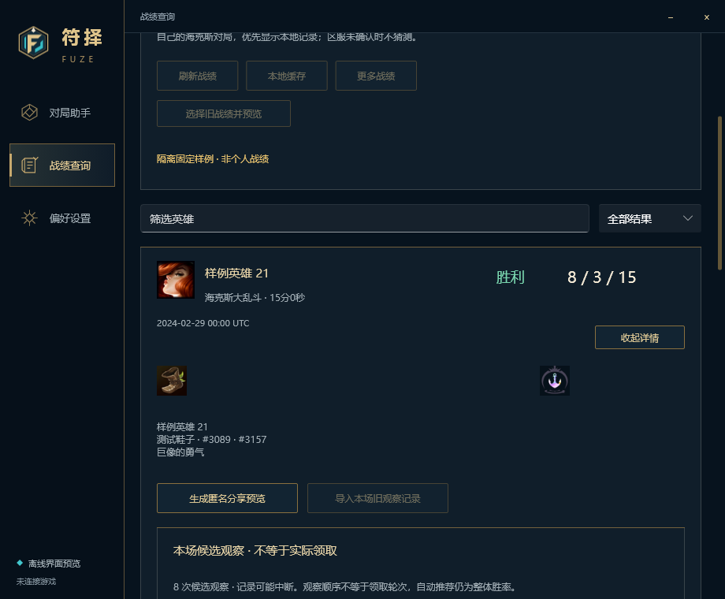
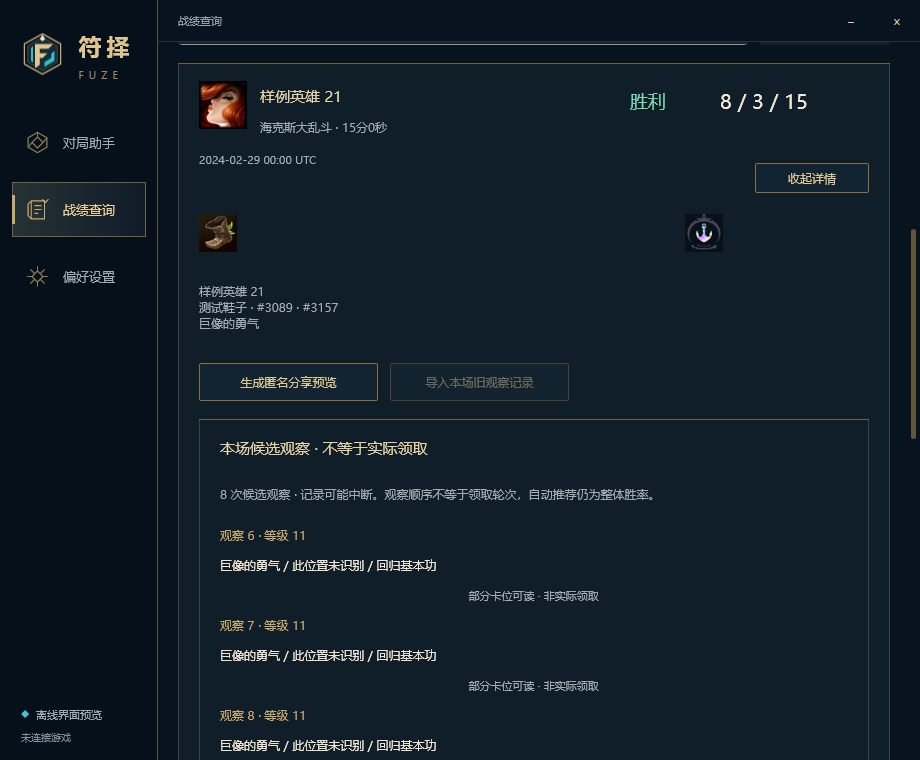
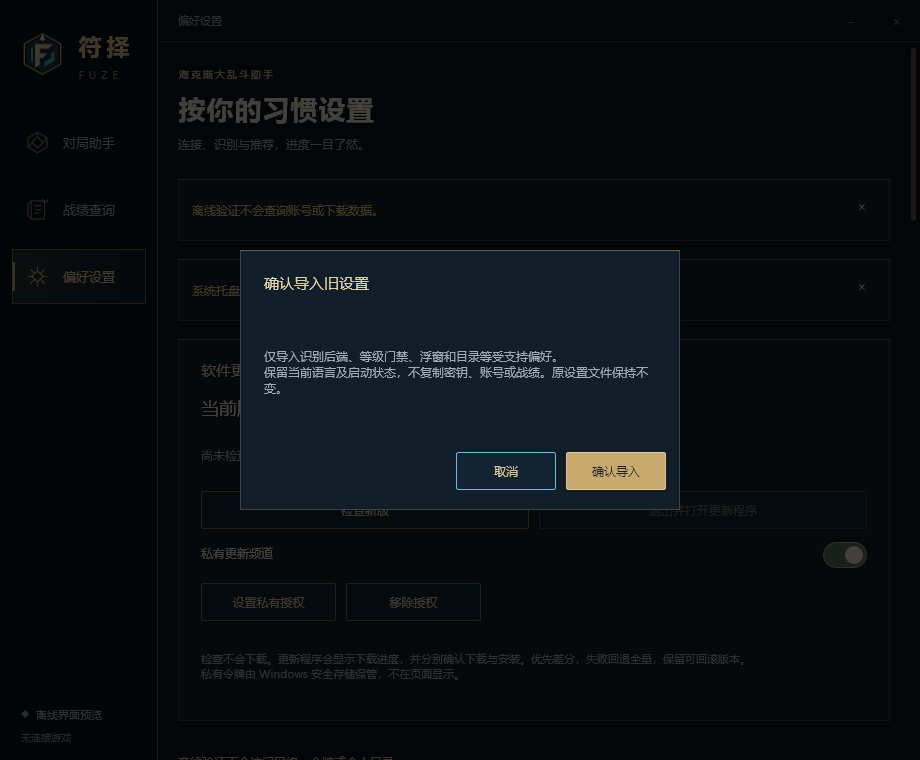
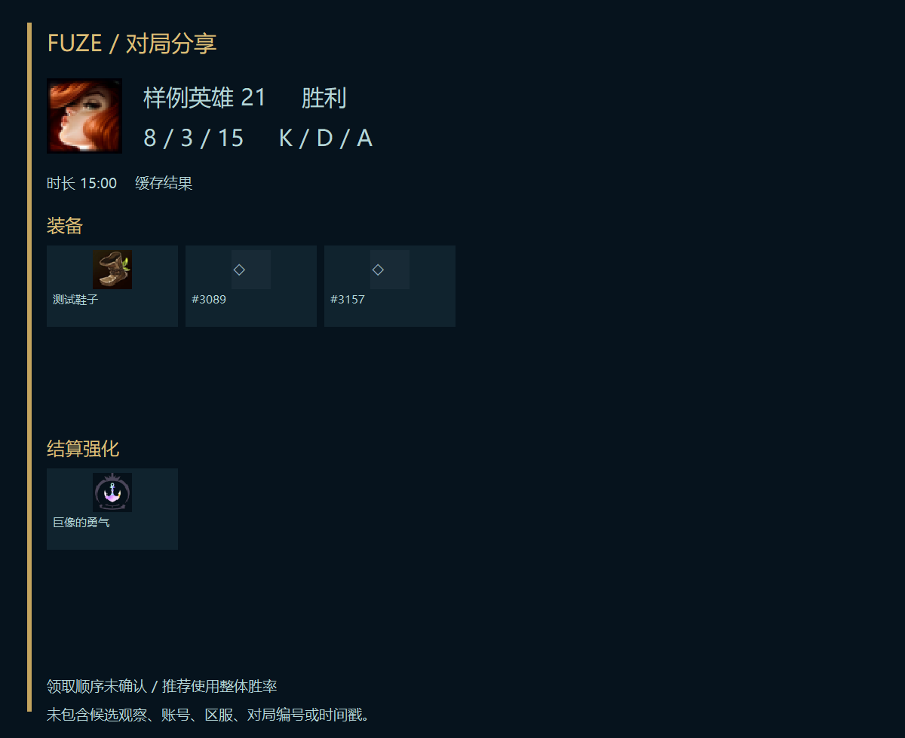

# Slint 战绩、观察记录与显式迁移

本批基于 PR #54 的 `feat/slint-startup-maintenance`。PR #54 的 Windows CI 已成功。保持 v0.6.3 中文侧栏、深蓝金色组件和卡片展开结构；不修改稳定版，不打包，不表示整体迁移已完成。

## 接入范围

- 战绩卡片补充英雄、装备和结算强化图标、明确 UTC 的日期。展开后在该场卡片内查看候选观察与匿名分享，避免与其他对局混淆。观察按五条分页，缺失卡位显示“此位置未识别”，中断与截断记录有提示。
- 观察顺序、等级、结算强化均不推断实际领取轮次。匿名导出保留 `actualClaimRound: null`、`recommendationScope: overall`，三卡推荐仍为整体胜率。
- 复用现有匿名图片/JSON 服务，先生成本地预览，再由用户明确选择保存或复制。图片与 JSON 不含账号、区服、对局编号、时间戳；JSON 可包含匿名候选观察。保存采用新建文件，拒绝覆盖，不自动上传。
- 旧战绩由用户选择文件，先验证当前账号/区服并预览，再按场次选择、确认。确认时再次校验账号，区服不明确不猜。空选择、重复场次、预览以外的场次均拒绝。取消或失败恢复之前的缓存视图，原文件保留。
- 旧观察记录只能显式绑定到选定对局，复用已有身份校验和记录校验，不按时间相近自动关联。导入内容始终标注为观察。
- 旧 Electron 设置通过受支持字段白名单读取、预览确认并交给现有偏好应用服务。保留当前语言与运行状态，避免绕过尚未完成的 Slint 多语言事务或擅自恢复识别；密钥和账号不进入偏好导入。
- 更新频道控件与持久偏好共用同一状态，移除重复开关。频道变化后失效旧的“可安装”结果，要求重新检查。

## 性能和安全边界

图片、分享生成、迁移文件读取与保存均在工作线程处理。空闲条件变量等待，结果定时器只在请求期间运行。当前战绩页最多六场，每场最多二十个图片引用；内存缓存限制 192 张，磁盘缓存沿用已有 256 文件限制与公开域名白名单。下载失败退避，翻页后旧请求不再提交结果。不会在截图/OCR 热路径增加哈希或图片编码。

分享/导入需要暂停并取得维护锁，期间拒绝恢复识别或另起维护操作。离线验证入口在文件选择、网络、剪贴板之前拒绝相应操作。图片文件由既有受限解码服务处理。

扩展 Slint 组件后，低优化功能构建初次在组件创建阶段发生主线程栈溢出。MSVC 入口现预留 8 MiB 虚拟栈地址，实际页由 Windows 按需提交；隐藏窗口再次验证通过。它不是将 8 MiB 全部作为常驻内存，也不是修复实战性能的证据。

## 验证

- 定向测试：`selective_preview_never_adds_unreviewed_matches_or_claims`。
- 隐藏自有窗口 `--review-host`：图标、候选观察分页、匿名分享字段、切换后清除旧内容、离线剪贴板拒绝、旧设置取消/确认、保留语言/暂停状态、更新频道一致性。复用同一宿主验证流程，无系统输入或游戏接口。
- 920×760 渲染检查修正装备图标与文字重叠，确认弹窗默认聚焦取消。分享预览和新页面保持中文及现有深蓝金色样式。
- 本机使用 `cargo rustc --release ... -- -C opt-level=0 -C codegen-units=256` 的功能构建以控制编译内存；不能据此宣称发布性能。Windows CI 保留正常 release 优化。
- 本批没有执行真实账号旧战绩导入、剪贴板写入、真实下载与安装、可见窗口游戏共存验证。合成图片和检查结果只覆盖开发侧边界。

最终功能构建、隐藏宿主联调和启动冒烟均退出 0；定向测试 1 项通过，格式与隐私扫描通过。[机器可读记录](record-actions/host-review.json) 继续保留 `production_parity_complete: false`。

## 仍需完成，尚不能判定 v0.6.3 完整一致

1. 选人页面攻略跳转、装备方案确认/反馈，以及所有英雄和强化的动态图片接线；本批公共图片适配器先用于战绩。
2. 未绑定到在线战绩的个人观察记录入口与完整交互对照；本批完成的是按场次绑定的观察详情。
3. Direct2D 三卡说明交互、拖动与位置记忆，旧隐藏控制窗口线程的收口。
4. 完整多语言事务、真实 IME、混合 DPI 跨屏与远程桌面恢复。
5. 阶段验收时的 Slint 整包下载、安装交接、健康检查和失败回滚。当前按要求不生成安装包。

后续以本清单继续推进，不将后台服务已存在或 CI 通过当作整套产品已经验收。
