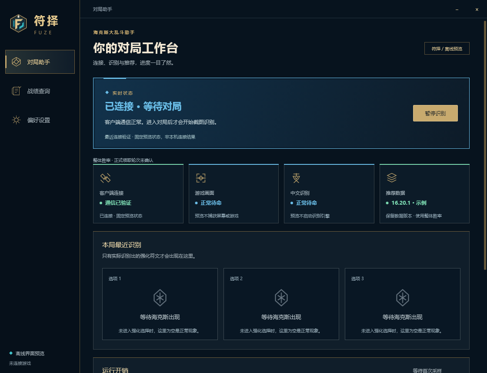
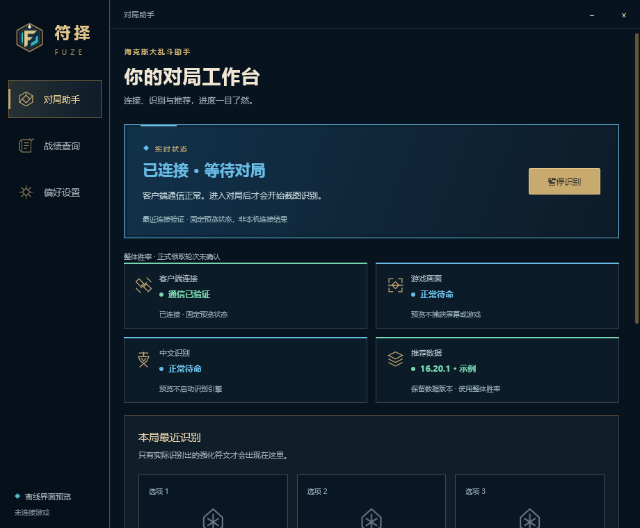
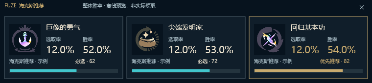
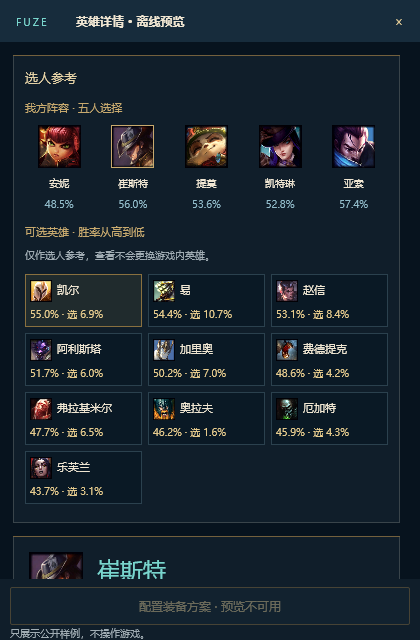

# 中文界面恢复：首批开发侧结果

> 后续服务接线和仍未完成的范围见 [HOST_INTERACTIONS.md](HOST_INTERACTIONS.md)。本文保留为首批视觉恢复记录。

2026-10-16。基准仍是 `v0.6.3 / 58aea5e`，按 [设计审查](../../../docs/development/rust/V063_UI_DESIGN_AUDIT.md) 修复。**这不是完整迁移完成报告，也不是玩家验收通知。** 稳定版保留，不打包；新界面仍处于隔离 ui-lab。

## 已恢复并查看的画面

- 主窗口：184px 侧栏、42px 标题栏、原品牌 SVG、原 RuneGlyph 图标、中文版标题/副标题/标签；原色板和主要排版层级。
- 首页：语义状态色、原因和验证说明、单个暂停操作；四模块与数据版本；三卡外层面板、卡位/空状态/缺失提示/梯队；运行开销、等级调度、数据来源与页脚。
- 920px 宽：158px 侧栏与2×2模块；真实 Winit 尺寸事件处理后再保存图像，断言图片尺寸与模块宽度，不把请求尺寸当成布局成功。
- 完整/缺失三卡：恢复760×170，缓存中已有的符文图标、并排选率/胜率、推荐分数和较明显进度条。品牌图不再冒充符文图。图像解码在 Scene 建立时完成，设备位图按目标生命周期缓存。
- 选人上半部：原色板，五人阵容、自己标记边框、10个候选网格一览；候选按公开样例胜率排序。维持用户确认的网格例外。
- 设置/战绩：恢复独立页面与面板层级、数据缺失说明；导航不再只是更换工作台标题。

## 必须继续的工作

| 范围 | 本轮状态 | 下个完成条件 |
|---|---|---|
| 首页视觉 | 首批完整结构与常见状态已恢复并实际查看 | 接入宿主真实状态后复核长文、时间、错误和滚动；不是完整产品验收通过 |
| 设置 | 外壳/分区恢复，当前值待读取，操作禁用 | 复用现有 Rust 偏好/更新/存储/目录/诊断契约，真实控件和确认流程接线，核对旧版交互 |
| 战绩 | 空状态及固定列表预览 | 接回已有账号隔离缓存、查询/分页/筛选、详情、观察记录、分享和选择性迁移 |
| 选人 | 五人+候选网格与英雄摘要、页签 | 完整海克斯池、稀有度、攻略、出装/技能/路线、图标、阶段统计及显式装备配置接线 |
| 局内三卡 | 紧凑绘制、真实示例图标、缺失卡位 | 接回实时模型、刷新保留、统计、关闭状态、可访问性与完整稀有度/最优标记体系 |
| 局内侧栏 | 本轮未迁入 | 共享英雄详情数据与组件，不重复联网/解码 |
| 窗口 | 主窗口按钮回调和退出确认已实现；隐藏 resize 通过 | 可见拖动/最小化、关闭/焦点/键盘、真实跨屏与 IME；选人置顶/恢复仍待完整窗口接线 |

不会以示例按钮点击冒充业务成功，也不会把已有旧 Rust 页面算作新框架已接通。设置/查询/诊断/装备等未接回的操作均保持不可执行。示例连接状态、版本和战绩明确标识为预览，不访问本机账号或游戏。

## 验证与性能

- release + gpu、固定锁文件编译通过；格式和 diff 检查通过。
- 原生隐藏 Winit 主窗口，实际检查尺寸为1120×860和920×760；主页面多状态、底部折叠、退出确认、设置/战绩/选人共15个画面。布局状态直接写入组件模型，没有模拟系统输入。
- 选人快照来自当前 Slint 组件。该同步快照期间未观察到其原生窗口句柄（JSON为null），因此只算渲染证据，不声称选人真实窗口行为通过。
- [Skia原始记录](restoration/native-skia.json)：首页12次热光栅快照，中位数4.68ms、P95 6.60ms；不是GPU帧。
- [OpenGL探针](restoration/skia-surface-opengl.json)：RTX3060Ti，1120×860时呈现前中位数2.67ms，呈现及完成等待14.02ms，合计16.69ms；有限空闲检查0次重绘，主动上下文重建通过。不是可见窗口或实战帧率。
- Direct2D：96/120/144/168/192 DPI的完整/缺失图生成；96DPI WIC热绘制中位数1.18ms。隐藏自有硬件窗口样式/资源重建通过，空闲无绘制；不把隐藏呈现当作游戏覆盖证明。
- 没有启动稳定版、连接游戏/LCU、读取玩家日志、操作鼠标、注入键盘或新建安装包。

先完成上表的开发侧恢复与接线，再运行人工验收清单。当前整体仍是**不放行全面迁移/发布**。
