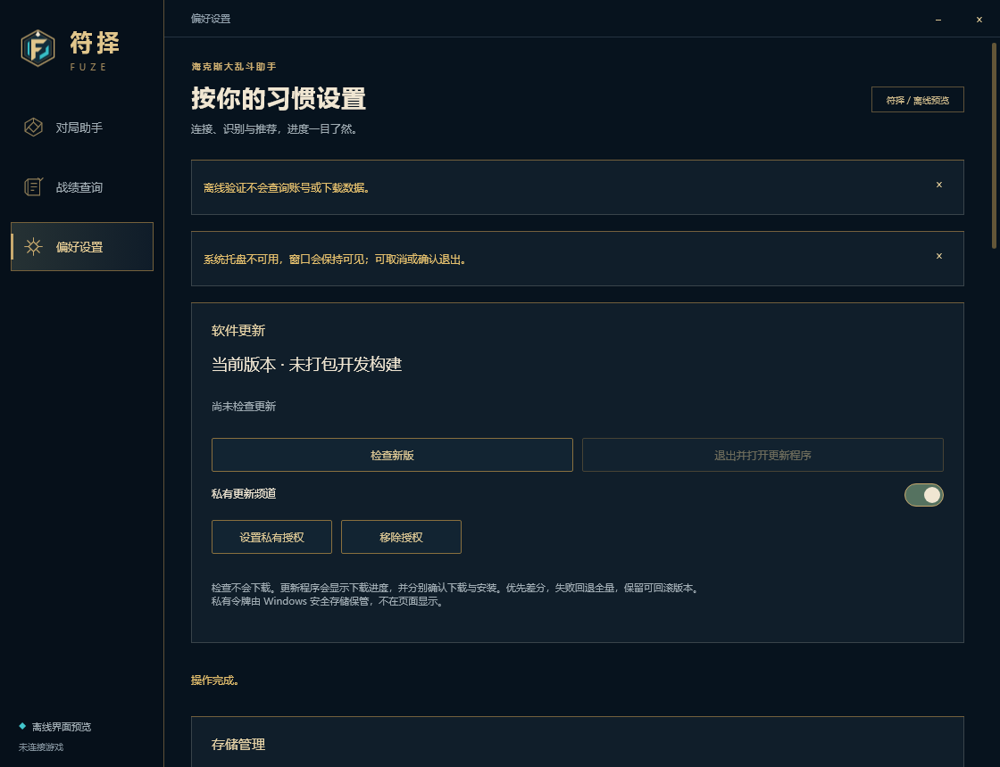
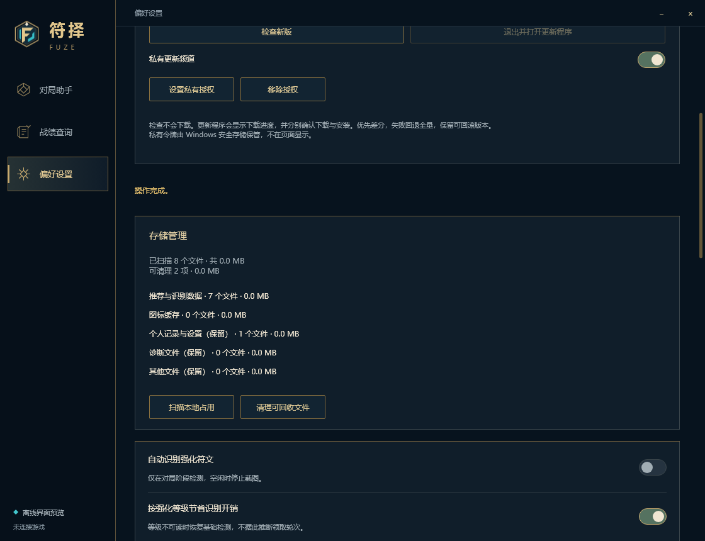
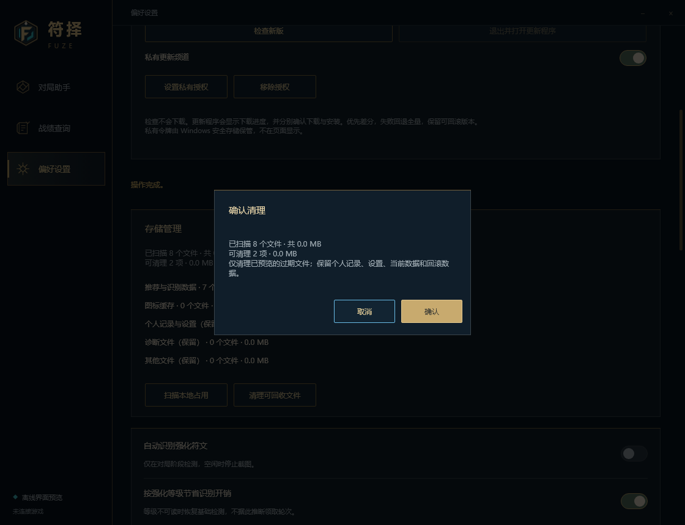
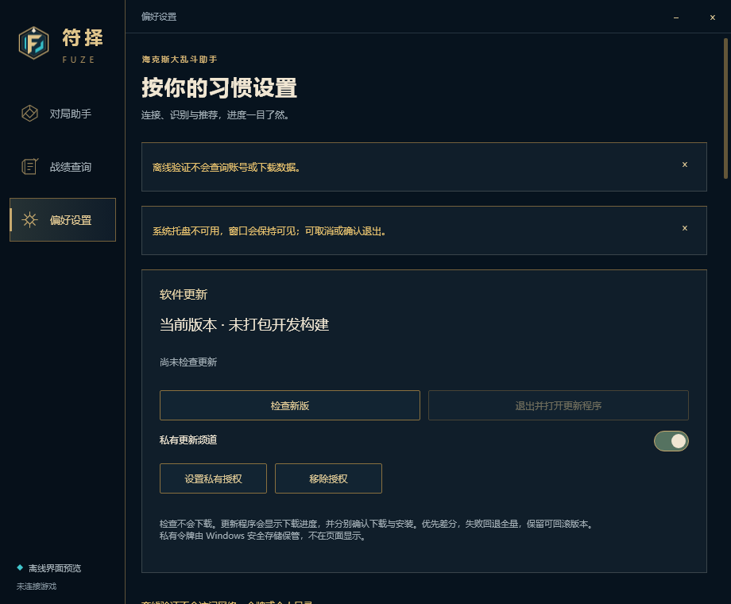

# Slint 启动与维护页面

基于 PR #53 的 `feat/slint-live-overlays`，继续对照 v0.6.3 中文界面与已确认的候选网格改动。PR #53 的 Windows CI 已成功。本批不制作安装包、不替换稳定版，也不表示完整功能已验收。

## 实现范围

- `--desktop preview.json` 通过现有 Rust Session 接入生产宿主，复用有界配置读取；不会建立第二套识别循环。生产与旧宿主共享单实例互斥量。实际生产入口未在玩家机器启动。
- `--managed-desktop` 对接现有 READY/HEALTHY 两阶段协议；初始资料就绪并实际渲染后才报告 READY，事件循环稳定运行后报告 HEALTHY。健康检查完成即停止定时器；提前退出不报告成功。
- 包内 `build.json` 可声明 `uiFrontend: "slint"`，受管启动器据此选择 Slint；未声明时仍走旧 Win32 入口。未知值与缺少可执行文件拒绝，安装前自检也检查所选入口。没有修改当前发行包或生成新包。
- 软件更新页：当前构建标识、公开/私有频道、检查、私有授权管理和更新交接。令牌只经既有 Windows 安全存储与原生输入框，不进入 Slint 模型或日志。检查不会下载；失败保留当前运行版本，曾失败/待验证版本明确显示原因。
- 用户确认更新后，先停止当前宿主、释放单实例锁，再打开配套 `fuze-update.exe`。实际下载进度、差分、单次全量回退、安装确认和失败回滚仍由已有更新程序负责，**不是在 Slint 中重新实现或重复下载**。缺少配套程序时保持当前会话并提示。
- 存储页：显式扫描分类与容量，清理前预览和二次确认。复用既有过期、路径、变更复核与当前/回滚版本保护；设置和个人记录保留。无法确认保护信息时不清理相关数据。
- 维护时要求暂停识别并确认宿主已暂停，操作结束前禁止恢复识别或修改设置。IO 在独立工作线程执行，空闲用条件变量等待；结果等待定时器只在请求处理中运行。修正退出时可能遗漏唤醒的边界。
- 确认弹窗默认聚焦“取消”，Escape/背景取消，Tab 留在确认区域；系统关闭时取消原维护确认，避免叠加两个确认。生产页标题、连接文案与页脚不再固定写“离线预览”。

## 验证范围

使用显式合成数据及隐藏自有 Slint/Win32 窗口，无游戏接口、系统输入、真实授权、个人记录读取、安装或更新操作。`--review-host` 验证存储扫描、取消不删除、清理过期测试数据、保留当前/回滚/合成记录、维护期间禁止恢复识别、离线拒绝网络、确认焦点及 920px 窄窗口。`--desktop-smoke` 验证配置到渲染、隔离单实例占用/释放、暂停/恢复/退出、隐藏与前台不变。

本机发布优化编译首次因虚拟内存分配失败退出。随后仅对顶层界面程序使用 `cargo rustc --release ... -- -C opt-level=0 -C codegen-units=256`，保留依赖既有优化，用于功能和布局验证；不以该构建宣称发布性能。Windows CI 保持正常 release 优化。

定向回归验证旧包默认 Win32、显式 Slint、未知入口和缺失入口；只运行这一项服务测试。隐藏联调曾因外部前台变化中止，复跑通过；这不构成真实用户焦点/游戏共存验收。界面图片来自合成数据的组件渲染，没有桌面或游戏截图。

最终本机功能构建、隐藏宿主集成、启动冒烟和定向回归均退出 0，格式与差异检查通过。[宿主验证记录](startup-maintenance/host-review.json) 明确保留 `production_parity_complete: false`。真实授权、联网更新下载、可见窗口及游戏链路未执行。

## 尚未达到完整迁移的项目

1. Slint 包的实际下载、安装交接和受管启动失败回滚整体验证；本批只接线并做离线验证，没有发布真实包。
2. 战绩完整图标、图片分享、观察记录详情及选择性旧数据迁移页面。
3. 攻略跳转、配置装备方案的确认与反馈，以及所有英雄/装备/强化的动态图标缓存。
4. Direct2D 三卡说明交互、拖动/位置记忆；旧隐藏管线窗口的控制线程仍未移除。
5. 完整多语言事务、可见窗口的键盘与中文 IME、跨屏 DPI/远程桌面和最终 v0.6.3 对照验收。

三卡自动推荐仍使用整体胜率；实际领取轮次没有因 UI 接线而获得确认。上述缺口补齐并阶段验收之后才制作测试安装包。
